# Token Bank

> ## Your AI needs a manager.
>
> **Personal AI hub · An agent app factory.** One local gateway and one key for models *and* agents: the Claude Code, Codex, Cursor and Kimi Code apps on your machine, the professional agents you set up in Assets, external agents you connect, and agents you hire from the community. See every token, spend less, keep every AI asset in one place, hand problems to the butler, and rent out what sits idle.
>
> Open source · Keep your workflow · One-click revert · Desktop / CLI / Docker web UI

[Website](https://tokenbank.wink.run) · [Free download](https://github.com/wink-run/tokenbank/releases/latest) · [▶ Watch on YouTube](https://www.youtube.com/watch?v=AYLIdneVEgc) · [中文文档](./README.zh-CN.md) · [Architecture](./DESIGN.md) · [Privacy Policy](./docs/PRIVACY_POLICY.md)


---

## 0.7.0: from model gateway to agent app factory

Up to 0.6, Token Bank focused on the **model layer**: onboard your AI apps into a local gateway, swap models, route requests, and see every token.

0.7.0 makes **agents** first-class. The same gateway and the same key now call models *and* dispatch tasks to agents. Above the gateway, the runtime, asset, interface, observability and distribution layers are built too, so with the model layer you get six ready layers and can build your own apps on top without writing a harness, billing or web pages from scratch.

| 0.7.0 | What you get |
|---|---|
| **New interface** | Gateway, Models, Assets, Usage and Trade open on the current state; click in to change things |
| **One API** | One gateway key and one base URL for models and agents; each agent can also get its own key |
| **External agents** | Agents that run elsewhere, such as Muse or GrokBot, connect with a pairing code; you assign work, they send results back |
| **The butler** | Hand asset, projection and task problems to the butler: it fixes what it can and only asks you when a decision is yours |
| **Full desktop in Docker** | Open a browser on your server and get the same gateway, assets, playground and sessions as the desktop app |
| **Web app & hiring market** | Shared agents get their own web card that anyone can open and hire from; when listing, choose public or specific circles per item |

Also in this release: set the keys a skill needs right in Assets; the Usage page switches by device chips, with the same devices as your profile; the Tools page registers MCP servers, HTTP APIs and local CLIs; Trade is three tabs (buy / sell / earnings) and every listing picks its own scope. **Removed**: the work portrait and model-driven recommendations (the community catalog is now searched and enabled directly), the Trade page's “sharing network” entry, and the butler's scheduled self-review reports — the butler no longer spends tokens on its own.

See the [v0.7.0 release notes](./client/releases/v0.7.0.md).

---

## Overview

**Token Bank is a next-generation personal AI resource hub** that enables one-click onboarding and intelligent orchestration of mainstream AI tools like Claude, Cursor, Codex, and WorkBuddy through a local gateway architecture.

### Core Value Proposition

- **Usage Transparency**: Full-chain trace makes every token consumption accountable
- **Cost Optimization**: Smart routing automatically switches between local models, free quotas, paid subscriptions, and community-shared compute with lossless protocol adaptation
- **Sharing Economy**: P2P compute-sharing network creates a decentralized exchange for models and agents, monetizing idle resources into credits

### Technical Highlights

**Zero-Intrusion Integration**  
Declarative application handlers (CLI env injection + config hot-patching) enable seamless onboarding without modifying agent applications.

**Multi-Protocol Adaptation Layer**  
Transparent protocol conversion (Anthropic Messages, OpenAI Chat, Codex Responses) allows agents to use third-party models without awareness.

**Unified Asset Layer Architecture**  
Community agents run directly on users' existing agent applications (Codex, Claude, Cursor, etc.) without rebuilding harnesses, executing within user-accumulated MCP/Skill/Prompt assets for dual reuse of runtimes and tool ecosystems.

**Scenario Routing Engine**  
- Routing policy learning from usage patterns
- Lossless context compression
- Vision enhancement layer for non-multimodal models (automatic image recognition injection)

**MCP Built-in Relay & Resource Projection Gating**  
Constructs personal knowledge and tool ecosystems with controlled resource deployment.

**AI-Native Architecture**  
Abandons traditional hard-coded rules; a built-in **butler** handles projection repair, asset checks (duplicates, risky skills, new versions), install retries and route fallback by rules, using a model only when rules are not enough—managing agents with an agent. It never spends tokens on its own.

**Learns from you**  
Every correction you make becomes a rule the butler follows next time, and agent routing remembers who you send which work to. Multi-device usage aggregation, agent orchestration, and more make Token Bank truly **smarter with you**.

**New in 0.7.0:** the gateway no longer only forwards model calls. The **unified agent API** `/v1/agent` uses the same key to dispatch tasks to four kinds of agents (local apps, professional, external and hired agents), returning synchronously, in the background or as a stream; **agent routes** let a main agent read your rules and pick who to dispatch to; **external agents** register with a pairing code, long-poll for tasks, return results and push messages; the **butler** handles asset, projection and task problems by the rules you taught it, and hired tasks pass a safety check first.

---

## Why Token Bank

**Eight AI headaches. One hub.**

| Sound familiar? | What Token Bank does |
|---|---|
| **Too many AI tools** — each configured differently, switched by hand | **One-click onboarding**: every tool behind one local address; revert to the official config anytime |
| **Bills keep growing** — no idea where the tokens went | **Full-chain trace**: app, model, tokens and cost for every call, merged across devices |
| **Quota expires unused** — free tiers idle while paid usage climbs | **Smart routing**: local and free sources first, native model names unchanged, protocols converted automatically |
| **Skills & MCPs everywhere** — copy-pasted, out of sync | **AI assets in one place**: MCP / Skill / Prompt / Agent in one library, projected to the agents that need them |
| **Top models out of reach** — rare models and expert agents feel unreachable | **Sharing market**: pay per call in credits to use rare models or hire expert agents |
| **Idle capacity wasted** — unused subscriptions, local models gathering dust | **Earn from idle**: rent out models and agents for credits — API keys, Skills and configs never leave your machine |
| **Agents live in silos** — putting one into your product means writing a harness, API and billing | **Unified agent API**: one key for models and agents, change `harness_id` to change agent; list it and get a web card |
| **You debug everything yourself** — missing skills, broken projections, tasks that won't run | **The butler**: fixes what it can, asks only when the call is yours, and remembers every correction |

**Token Bank is your personal AI hub — and an agent app factory.** Plug Claude Code, Codex, Cursor, WorkBuddy, Kimi Code and more into one local gateway without changing how you work: **see clearly, spend less, stay simple**, keep your AI assets in order and let them **get smarter with you**, call models and agents with one key, orchestrate a team of agents from one sentence, and **earn from idle** by renting out what you don't use.

**Five pillars:**

| Pillar | What you get |
|---|---|
| **See clearly** | One-click onboard; full trace; multi-device analytics; subscriptions vs PAYG side by side |
| **Spend less** | Seamless model swap; smart local-first + task-type routing; scene strategies; optional lossless compression |
| **Stay simple** | One-click onboard/restore; all AI assets in one library, projected to every agent; one key for models and agents; problems handed to the butler; multi-account CLI by directory; tray status; one local address |
| **Get smarter with you** | The butler remembers the rules you teach it — correct it once and it won't repeat the mistake; dispatch preferences sharpen with use; duplicate, risky or outdated assets are flagged automatically |
| **Earn from idle** | Rent out idle models and agents for credits (keys and Skills stay local); rent rare models or hire expert agents per call; each listing public or for chosen circles |

---

## Architecture

```
┌─────────────────────────────────────────────────────────────────┐
│  Desktop (Electron · Mac / Windows) or CLI / Docker Web UI      │
│  Gateway · Models · Assets · Playground · Usage · …          │
└────────────────────────────┬────────────────────────────────────┘
                             │ loopback
                             ▼
┌─────────────────────────────────────────────────────────────────┐
│  Local gateway  :11430/v1                                       │
│  · Anthropic Messages / OpenAI Chat / Codex Responses adapters  │
│  · keyScene rewrite · scene/task-type routing · compression     │
│  · MCP: built-in tokenbank tools + relayed third-party MCP      │
│  Agent API  :11430/v1/agent  (0.7.0)                            │
│  · local apps / professional / external / hired · agent routes  │
│  · shared gateway key · per-agent keys · sync / background / SSE │
└───────────────┬─────────────────────────────┬───────────────────┘
                │ local keys stay on device     │ login + relay key
                ▼                             ▼
     Ollama / free API / sub / PAYG      Token Bank cloud
                                             │
                              ┌──────────────┼──────────────┐
                              ▼              ▼              ▼
                         Community P2P   Remote agents   Multi-device
                         (WebSocket)     (run elsewhere) usage merge
```

**Implementation notes:**

| Layer | What it does |
|---|---|
| **App handlers** | Declarative `app-handlers.yaml` for CLI shim / config-file patch / session scan; WorkBuddy, Trae, Hermes, Kimi use strong install signals |
| **Routing** | Unified “route = selector chain”: personal/community/free/paid filters + task-type presets (`design` / `repo-qa` / `chore` / `debug`) |
| **Resource projection** | Skill / Prompt / MCP only onto **hosted and installed** targets; apps without stdio use the built-in MCP relay |
| **Telemetry** | Live gateway logs + local session import (Claude / Codex / Cursor / WorkBuddy Trace, …) with auto-dedupe |
| **Agent API** | `/v1/agent/responses` dispatches tasks; `harness_id` picks an agent or an agent route; external agents use `/v1/agent/external/*` to register, pull and return |
| **Butler** | Watches asset, projection, gateway and task events, acts by rules (undoable), and turns corrections into rules |

### Six ready layers

A model gateway only covers the bottom layer. Token Bank builds every layer from execution to distribution, so you only work on the top:

| Layer | Includes | What you get |
|---|---|---|
| **Distribution** | Listing, market, circles | List it and get a web app; serve with or without a public IP |
| **Observability** | Trace, usage, devices | Every call traceable, rolled up across devices |
| **Interface** | Agent tasks + three model protocols | Change `harness_id` to change agent; the three model protocols interoperate |
| **Assets** | Skills, MCP, prompts, agent templates | Composed into agents, projected to runtimes |
| **Runtimes** | Every agent runtime | Installed Claude Code, Codex, Cursor, Kimi Code and others become execution engines |
| **Models** | Every provider + scene routing | Local, free, subscription, PAYG, community, with fallback |

---

## Agent gateway: one key for models and agents (0.7.0)

The Gateway page is split into **general, professional and external agents** plus **routes**. Every agent can be tried in the Playground and called from the API.

| Agent | What it is | Where it runs |
|---|---|---|
| **General** | Local apps such as Claude Code, Codex, Cursor, Kimi Code, Pi | Your machine |
| **Professional** | Agent templates from Assets (prompt + skills + model) projected onto an app | The app it is projected to; pick a default when projected to several |
| **External** | Agents that run elsewhere, such as Muse or GrokBot, connected with a pairing code | Their own side; results come back to you |
| **Hired** | Agents hired from the community | The owner's device; you only receive results |

- **Agent routes**: a main agent reads your rules and picks one agent from the list; external, professional and local agents can all be on it. The Playground's “Agent routing” uses this
- **Keys**: models and agents share the gateway key, and app keys work too; each agent can also get its own key that only calls that agent, regenerated anytime
- **Three ways to get results**: wait for completion; add `background` to get a task id now and poll later; add `stream` for server-sent events

```bash
# List agents you can dispatch to (returns harness_id)
curl http://localhost:11430/v1/agent/harnesses -H "Authorization: Bearer $TB_KEY"

# Dispatch a task to an agent (or an agent route) and wait
curl http://localhost:11430/v1/agent/responses \
  -H "Authorization: Bearer $TB_KEY" -H "Content-Type: application/json" \
  -d '{"input":"Turn this week'"'"'s commits into a weekly report","metadata":{"harness_id":"<harness_id>"}}'

# Background: get an id now, poll later, cancel if needed
curl http://localhost:11430/v1/agent/responses -H "Authorization: Bearer $TB_KEY" \
  -H "Content-Type: application/json" -d '{"input":"…","metadata":{"harness_id":"<harness_id>"},"background":true}'
curl http://localhost:11430/v1/agent/responses/<id> -H "Authorization: Bearer $TB_KEY"
curl -X POST http://localhost:11430/v1/agent/responses/<id>/cancel -H "Authorization: Bearer $TB_KEY"
```

### Connecting an external agent

1. On Gateway → External agents, click **Connect external agent** to create a pairing code
2. The agent registers with the code (following the self-updating `tokenbank-connect` skill) and you click **Allow**
3. It pulls tasks (`/v1/agent/external/tasks`), returns results, and can push messages that appear in your current conversation
4. Disabling or removing it takes effect immediately; it only counts as offline after two missed heartbeats

### The butler

Hand problems with assets, projections or tasks to the butler:

- Click **Look** on a problem in Assets and the issue goes straight into the butler chat, where it uses the same actions as the Assets page
- It follows the rules you taught it first; correct it once and the rule sticks
- It keeps watch on its own: repairs broken projections, flags duplicate / risky / outdated assets, retries failed installs by cause, and tells you when a key is invalid, a quota is used up or an app is logged out
- It only interrupts you when a decision is yours; it never spends tokens or community credits on its own
- Hired tasks pass a safety check first; loosening the review needs your own confirmation
- Replies can include tables, lists and charts

---

## Core capabilities: one-click onboarding · seamless model swap · full trace

Token Bank is more than an API proxy — it brings **Claude Code, Codex, Cursor, WorkBuddy, Kimi Code, OpenClaw**, and other mainstream agents under one local gateway. **No agent-side changes required** for usage tracing, third-party model switching, and smart routing.

### One-click agent onboarding

Open the **Gateway** tab — installed tools appear automatically (desktop apps can be added manually):

| Agent | How it connects |
|---|---|
| Claude Code / Codex CLI / OpenCode / Hermes / Kimi Code | CLI shim: injects `BASE_URL` (and related) env vars — no command changes |
| Claude Desktop / Codex Desktop / OpenClaw / WorkBuddy | Config-file patch: one click to point at the local gateway (missing configs may be created after strong install detection) |
| Trae Work | Session import + manual gateway params inside the IDE |
| Cursor / Copilot / Qwen / Grok / … | Session stats, or set `OPENAI_BASE_URL` / a dedicated Gateway key |

**Onboarding flow:**

1. Click **Track** → start counting that app's token usage (even on the official subscription)
2. Pick a **model or scene route** in the dropdown → config is rewritten automatically; traffic goes through the gateway
3. Click **Revert** → restore the official config and stop tracking

Three states, clearly separated: **stats only** (official sub + session import), **via gateway** (route bound + live proxy), **reverted** (original config restored).

### Seamless third-party model switching

Agents keep their native model names (`claude-sonnet-4-6`, `gpt-5`, …). **The client never needs to change:**

```
Claude Code requests claude-sonnet-4-6
        ↓  gateway keyScene transparent rewrite
Actually routed → Groq llama-3.3-70b / local Ollama / DeepSeek / …
        ↓  protocol adapter
Anthropic Messages ↔ OpenAI Chat ↔ Codex Responses
```

- **Model names unchanged** — Claude client validation and UI stay the same
- **Automatic protocol conversion** — `/v1/messages`, `/v1/chat/completions`, `/v1/responses` each handled
- **Per-app bindings** — Claude Code on free Groq, Codex on local Ollama, independently
- **Switch back anytime** — choose "Direct (official)" in the route dropdown; config is restored cleanly

### Session trace (live proxy + session import)

Usage is traced whether or not traffic goes through the gateway:

| Mode | What it does |
|---|---|
| **Live proxy** | Requests via `localhost:11430` — logs route chain, resolved model, tokens, latency, cost |
| **Session import** | Tracked apps that still hit the official API — local session logs (`~/.claude`, `~/.codex`, WorkBuddy Trace, …) are scanned and imported |
| **Dedup** | Same call recorded by both gateway and session file → counted once |

Trace data appears on the **Dashboard** sliced by **app · provider · model · supply type · device · time**; the call log shows route result and latency per request.

### Smart routing

Supply is organized into **local sources** and **community sharing sources**. Each app can bind its own route; a global supply chain acts as fallback:

```
Per-app binding (keyScene / scene routes / task-type routes)
    ↓ unbound or llm-router-* model
Smart supply chain (unified “route = selector chain”)
    Local: Ollama → free API (Groq / GitHub Models) → subscription / PAYG API
    ↓ local unavailable or need extra compute
    Community sharing (spend credits on shared community compute)
    ↓ policy groups
fallback · round-robin · weighted · latency · direct
```

| Supply type | Includes | Notes |
|---|---|---|
| **Local sources** | Ollama, free API, APP/API subscriptions, pay-as-you-go | Forwarded by your local gateway; keys never leave the machine |
| **Community sharing** | Shared community compute network | Spend credits on remote nodes; model list synced dynamically |

- **Scene routes** — daily chat, code completion, long-doc analysis each get their own chain
- **Task-type routes** — presets like `design` / `repo-qa` / `chore` / `debug` (OpenCode-style inference routing)
- **Scope / price filters** — personal-only, community-only, free-only, or paid-only
- **Policy groups** — pick provider order from task features (tool calls, context length, …)
- **Failover** — local source down? try community sharing automatically; fully transparent to the agent
- **Egress guards** — clamp outbound `max_tokens` to upstream limits to cut avoidable 400s

### Model modalities

Provider models can be tagged **text / vision / image-gen / embedding**, driving Playground capabilities and Codex catalog `input_modalities` (vision models expose image input).

### Gateway lossless compression

Optional **lossless JSON compression** before forwarding — fewer input tokens upstream, **semantics unchanged**:

- Minifies pretty-printed JSON in messages (tool results, embedded data); strips whitespace only
- Non-JSON content is left byte-for-byte untouched — answers stay the same
- Enable in **Config**, or set `TOKENBANK_COMPRESS=1`
- **Dashboard** shows compression count, tokens saved, and ratio; cloud merge across devices when signed in

### Multi-device usage aggregation

Desktop, CLI, and server gateways each register as a device — **usage is reported and merged in the cloud** when signed in:

| Capability | What it does |
|---|---|
| **Device registration** | Each machine gets a persistent device_id; 60s heartbeat tracks online status |
| **Inventory snapshots** | Reports calls, tokens, cost, local / community sharing mix, top models/apps for 1 / 7 / 30 day windows |
| **Cloud merge** | **Profile** and **Dashboard** show per-device share, online status, detail vs aggregate views; the Dashboard switches devices with chips and marks this machine on its own chip |
| **Cross-device sync** | Subscriptions, PAYG config, and tool lists sync on login — no re-setup when switching machines |

### Unified subscription management

The **Profile** tab is the single hub for all billing accounts; **Models** handles keys and routing:

| Type | How it's managed | Typical use |
|---|---|---|
| **APP subscription** | Register ChatGPT / Claude / Gemini / Cursor plans and monthly cost | Stats-only on official sub, or OAuth → API gateway |
| **API subscription** | Separate catalog for vendor API plans (e.g. Volcengine Coding Plan) | API Key gateway, billed separately from APP subs |
| **Pay-as-you-go** | Register providers, model lists, and USD/M-token list prices | The Models page only exposes models configured here; cost estimates use these rates |

- **Cloud sync** — subscriptions and PAYG config download on login; Mac / Windows / Linux stay in sync
- **Billing overlay** — daily subscription amortization + PAYG estimates alongside raw token stats
- **Supply linkage** — Profile defines *what you use and what it costs*; Models defines *how to connect and route*

### Dynamic supply delivery

Local source catalogs and tool lists don't require manual version bumps — **sync on login, refresh when online**:

```
Server-maintained
    ├── Local source catalog (Ollama / Groq / GitHub Models / SiliconFlow …)
    ├── Tool list config.apps (agent onboarding rules, protocol adapters)
    └── Scene routes config.scenes (preset routing chains)
         ↓  auto-fetched on login / startup
Local gateway
    ├── Merged into ~/.tokenbank/tokenbank.yaml
    ├── Community sharing online models refreshed periodically (/v1/models → route candidates)
    └── One-click env scan — import existing free keys with round-robin
```

- **Local catalog delivery** — Groq, Cerebras, GitHub Models, NVIDIA NIM, etc. listed under **Local sources**; admins hot-update via YAML upload
- **Community sharing models** — online contributor models pulled live; no manual local registration
- **Env scan** — one-click import of existing Groq / GitHub Models / Anthropic keys; multi-key round-robin
- **Offline fallback** — built-in defaults when offline; server deltas merged automatically when back online

### Multi-account CLI & directory dispatch

Run multiple logins of the same CLI (Claude Code / Codex). The gateway picks the right instance by **working directory** so configs never collide:

| Capability | What it does |
|---|---|
| **Auto-scan** | Discover existing CLI account instances on startup or manual rescan |
| **Manual add** | Gateway → “CLI instance” for accounts the scanner misses |
| **Effective directory** | Bind each instance to a workdir; the shim injects env from `$PWD` |
| **Quota visibility** | Claude / Codex subscription meters; tray and app list show today’s usage |

### Agent orchestration (Playground)

**Debug / Playground** is more than a single-model chat. “Talk to” on the left follows the Gateway grouping: model chat, agent routing, general / professional / external agents and hired agents:

- Pick **Agent routing** and a main agent takes natural-language tasks (**image input** supported) and dispatches them by your rules
- The main agent can plan steps and dispatch to other onboarded agents (including Kimi / Cursor runtimes)
- **Community agents**: hire on demand from the Trade page; tasks run on **their device**, without downloading their source — lower risk than running unknown agents locally
- Built-in `tokenbank` MCP: `tb_list_agents` / `tb_dispatch_agent` / `tb_task_status` for orchestration
- Chunked conversation stream, visible tool calls, stop then continue
- Agent visibility is gated by **runtime projection + hosted install** — only projected, available agents appear
- External agents show “waiting to be picked up / picked up”, and messages they push land in the current conversation in time order

### AI assets in one place: MCP · Skill · Prompt · Agent

Skills in one folder, MCP configs in three, prompts in a text file you can't find — the **Assets** tab gathers the community catalog and your own assets into one ordered library, and **projects** them to every agent instead of copying them around. Edit once, and every managed agent gets the same version.

| Type | Capability |
|---|---|
| **Community catalog** | Search and filter community MCP / Skill / Prompt / Agent under **Add**, enable in one click (cache-first, built-in offline fallback) |
| **Tools** | Register MCP servers, HTTP APIs and local CLI tools; agents can call the tools projected to them |
| **Projection** | Project only onto **hosted and installed** targets; revoke anytime; cascade deps on onboard |
| **Built-in `tokenbank` MCP** | One MCP in every app: dispatch to agents, use models, fetch projected assets (`tb_list_resources` / `tb_get_resource`), call third-party MCP (`tb_call_mcp`). Per-app access: off / read / operate / full. Apps without stdio copy the relay config once |
| **Keys a skill needs** | Finds the variables a skill needs (declared in SKILL.md, or mentioned in its docs and scripts) and lets you fill them in; values stay on this machine and never ship with the skill; injected into tasks, written to a `.env` in the skill folder readable only by you, and optionally loaded from your shell profile |
| **Problems first** | Problem assets sort to the top; agent templates show where they are projected and which skills are missing; click **Look** to hand a problem to the butler |

---

## Five things it does

### 1 — See clearly

Token Bank logs every request: which route it took, which model answered, how many tokens, how long it took.

- **One-click onboard & inventory**: stats-only / via gateway / restore; per-app calls, tokens, cost
- **Full trace**: live proxy + session import with auto-dedupe
- **Multi-device analytics**: app · provider · model · cost · device · time; cloud merge when signed in
- **Subscriptions vs PAYG**: APP / API / metered side by side with daily accrual and list-price estimates

### 2 — Spend less

A **smart local-first routing chain**, with community sharing as fallback:

```
Local: Ollama → free APIs → subscription / PAYG
    ↓ unavailable or need extra capacity
Community sharing (spend credits on shared compute)
```

- **Seamless model swap**: native model names unchanged; protocols adapted automatically (including Codex Responses tool forwarding)
- **Scene / task-type strategies**: chat / completion / long docs / design·repo-qa·chore·debug; failover transparent to agents
- **Lossless compression**: fewer upstream input tokens, meaning unchanged

### 3 — Stay simple

- **One-click onboard/restore** on the Gateway page
- **Multi-account CLI** by working directory; menu-bar tray for status and today’s usage (brand logo + glass popover)
- **OpenAI-compatible endpoint**: point existing tools at one local address
- **Playground orchestration**: main agent takes tasks and hands off (including community agents); tool streams visible

### 4 — Get smarter with you

- **Teach once**: the butler follows the rules you taught it; correct it once and it uses the new rule next time
- **Better dispatch over time**: agent routing remembers your dispatch preferences and sends work to the right agent
- **Assets stay clean**: duplicate skills, risky skills and assets with new versions are pointed out; broken projections are repaired
- **Fill the gaps**: when an agent task lacks a skill, the butler finds one you can install from the community catalog

### 5 — Earn from idle

**Rent out idle AI. Rent rare AI.** The sharing market has two sides, both inside the same gateway:

| | Lender (your device) | Renter (community user) |
|---|---|---|
| **What** | List idle subscription quota, local or private models, and projected agents | Call rare or private models, or hire expert agents by the task |
| **Privacy** | Only a public card is shown; **API keys, Skills, Prompts and configs never leave your machine**; jobs run locally and only results go back | Nothing of theirs lands on your machine — you only receive results |
| **Credits** | Every call earns credits (outbound connection, no open ports) | Pay per call in credits — no extra subscription needed |

Contribute unused compute or API quota to **community sharing**, earn credits, spend them on shared models; or **list / hire agents** (tasks run on their device; configs and API keys stay local).

**You can contribute compute:** local Ollama, unused upstream quota, private LAN models (outbound WebSocket—no inbound port)

```
credits = (output_tokens / 1000) × contribute_rate × quality_multiplier (0.5–1.5)
spend   = ((prompt + completion tokens) / 1000) × consume_rate
```

Contribute rate > consume rate; plus check-in, wheel, and referrals. Circles share models and credits.

**Hire agents:** On the Trade page, list projected assistants (card/bio only) or hire community agents per use; jobs run on their device without downloading their source. Shared agents get their own web card that anyone can open, read and hire from. Hired agents appear under “Talk to” in the Playground.

**Choose the audience per item:** every model and agent you list can be public or limited to specific circles, so some can go to a circle while others stay public. The Sell tab shows how often each item was used and what it earned in the last 7 days, plus the tasks currently running for others.

---

## Quick start

### Desktop app (Mac / Windows — recommended)

Download the installer from [Releases](https://github.com/wink-run/tokenbank/releases/latest):

- **macOS** `.dmg` — double-click to install, lives in the menu bar, auto-updates
- **Windows** `.exe` — NSIS installer, auto-updates; title bar matches the app shell theme

After installing: open the app → go to **Config** → enter your backend URL and relay API key → done.

**Point your AI tools at the local gateway:**

```
OPENAI_BASE_URL=http://localhost:11430/v1
```

Create a local API key in the **Gateway** tab, or use an existing upstream key.

---

### CLI mode (Linux / servers)

```bash
git clone https://github.com/wink-run/tokenbank.git
cd tokenbank/client
npm install
node cli/gateway.js start
```

Open `http://localhost:11431` in a browser to configure. Works identically to the desktop app.

```bash
# Background (nohup)
nohup node cli/gateway.js start > gateway.log 2>&1 &

# Or with pm2
pm2 start cli/gateway.js -- start
```

---

### Docker (containerised)

```bash
git clone https://github.com/wink-run/tokenbank.git
cd tokenbank

# First deployment
./deploy.sh gateway

# Or with plain Compose
docker compose up -d gateway
```

**Since 0.7.0 the Docker build is the full desktop app in a browser**: open `:11431` and you get the same Gateway, Models, Assets, Trade, Usage, Playground and Sessions, usable on a phone too. Install CLI agents (Claude Code, Codex, Kimi Code…) into the container from the Gateway's app toolbox, log in once with something like `docker exec -it -u node <container> claude` (the login is kept in `/data`), and mount your project at `/workspace`, where agents work by default. Skills, MCP, HTTP APIs and local commands are all configurable in the container, and external agents can register to take tasks.

The `gateway-data/` volume is mounted automatically; **`local-config.json` is created on first start**. Configure routes and apps in the Web UI on `:11431`. See [`gateway-data/README.md`](./gateway-data/README.md).

| Port | Purpose |
|---|---|
| `11430` | Model requests (`OPENAI_BASE_URL=http://host:11430/v1`); agent API at `http://host:11430/v1/agent` |
| `11431` | Web management UI |

**Separate deployment:** the server and the gateway can be deployed and updated independently; see [DEPLOY.md](./DEPLOY.md).

```bash
# First server deployment
./deploy.sh server --https --with-deps

# Update the server (database keeps running)
./deploy.sh server

# Update the gateway (server unaffected)
./deploy.sh gateway
```

---

## What's in the UI

### Gateway · one-click onboarding & scene routes

Every AI app in one list with today's requests, tokens and last use; bind each app to a scene route (Coding / Speed first / Free sources…). The App toolbox installs / removes Claude Code, Kimi Code, Cursor, Codex, and more.

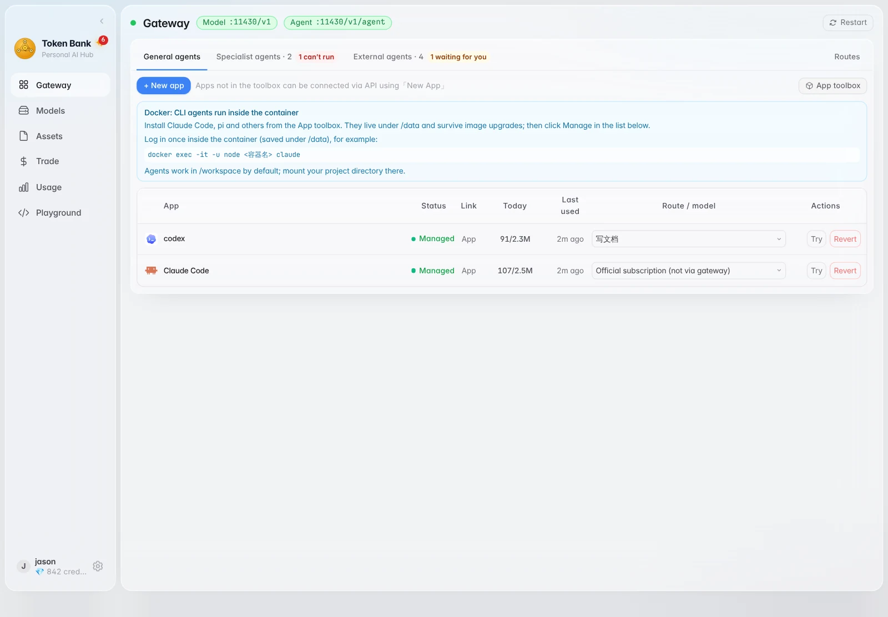

### Gateway · specialist and external agents (0.7.0)

Agent templates from Assets run on your installed apps and can each be called through the API by `harness_id`; agents running elsewhere join with a pairing code, and once you allow them they pull tasks and send results back.

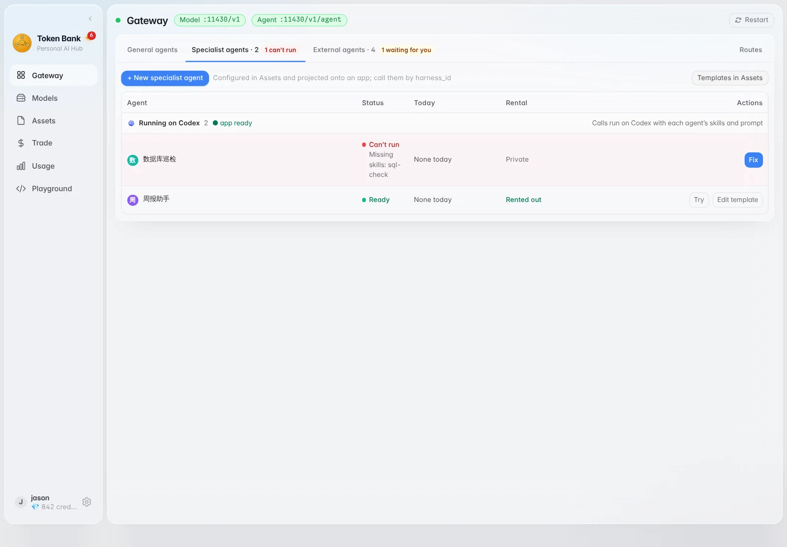

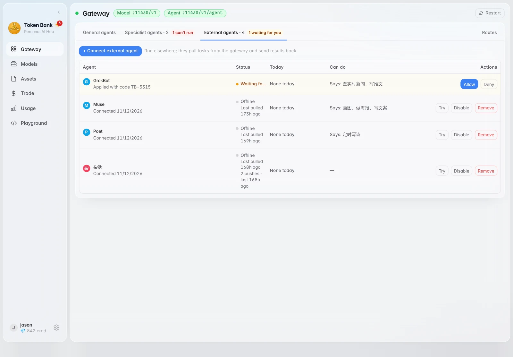

### Sessions · unified cross-app trace

Click an app's usage in the gateway list to open its details: data sources, per-model stats and session history, with a Trace for every session.

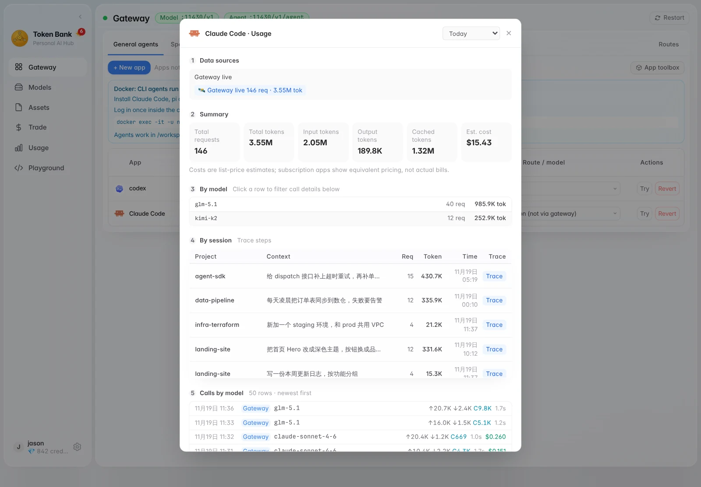

### Session Trace · step-level observability

Per-session steps, tool calls, skills used, and token breakdown (sealed reasoning when required by the API).

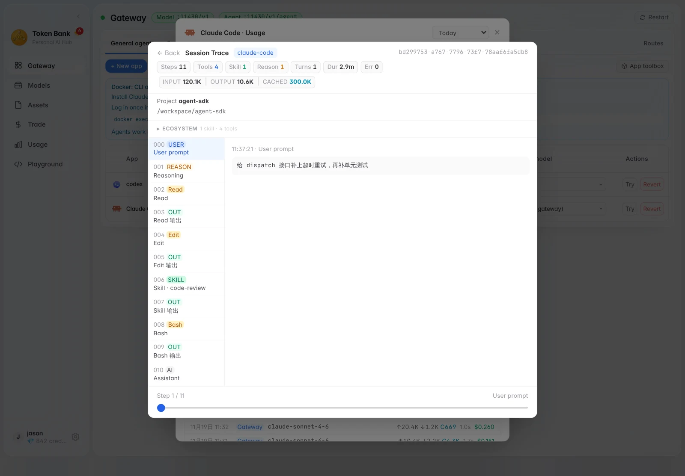

### Models · personal compute + community sharing

Speed-test personal models with status lights; spend credits on community-shared models.

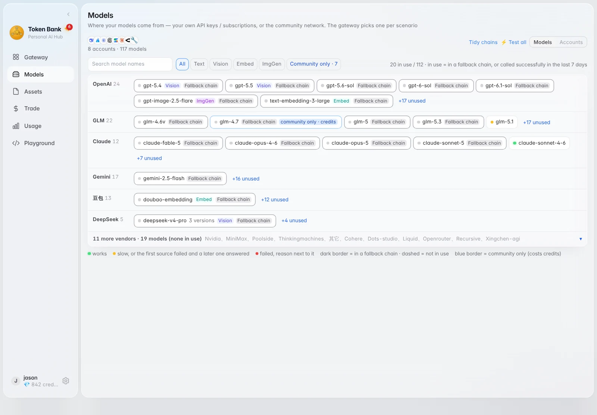

### Assets · Agents / Skills / Prompts

Prompts, skills, agents and MCP tools managed in one place and projected onto runtime CLIs in one click; problems sort to the top and **Look** hands them to the butler; the community catalog lives under **Add**.

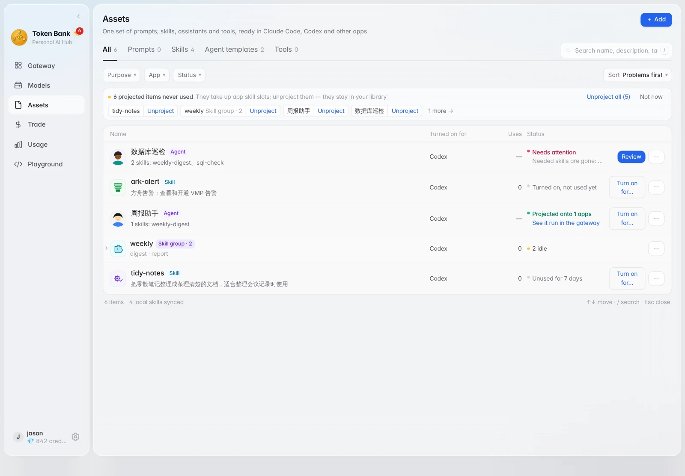

### Playground · agent orchestration

The main agent takes the task, runs tools, and dispatches sub-tasks in parallel to other agents such as Codex / Kimi Code; pick runtimes and managed agents on the left.

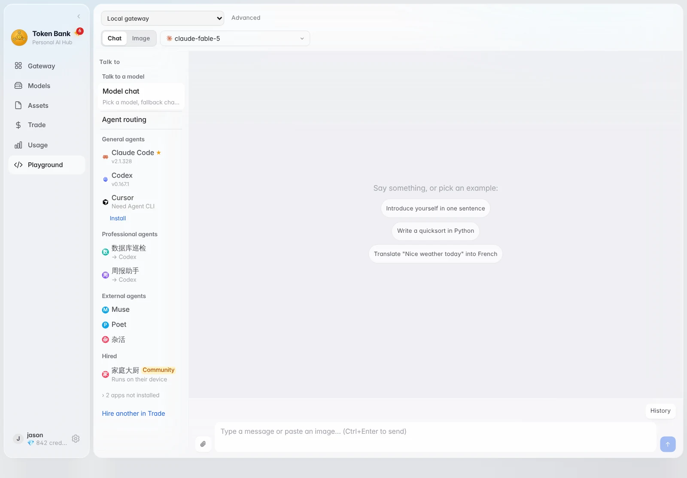

### Usage · spend visibility

Requests / tokens / free-hit rate / estimated cost (subscriptions prorated daily + pay-as-you-go); per-app mix and 7-day trend.

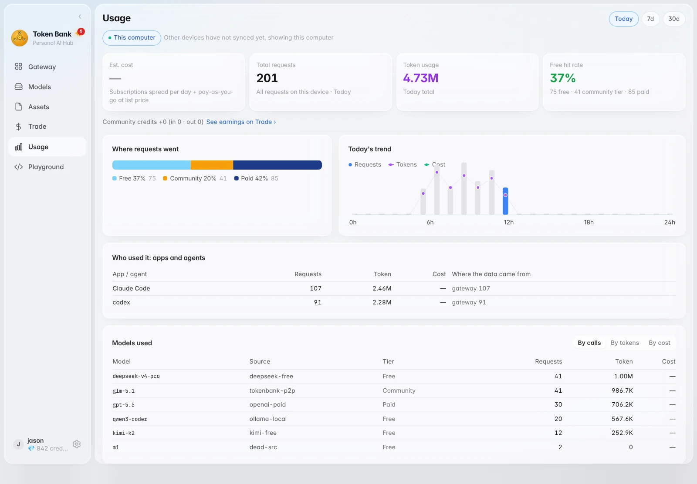

### Circles · trade only with people you trust

Circles are the scope of trading: create or join one under **Trade → Circles**, list supply to chosen circles, and filter hiring to circle-only agents. Inviting friends earns both sides credits.

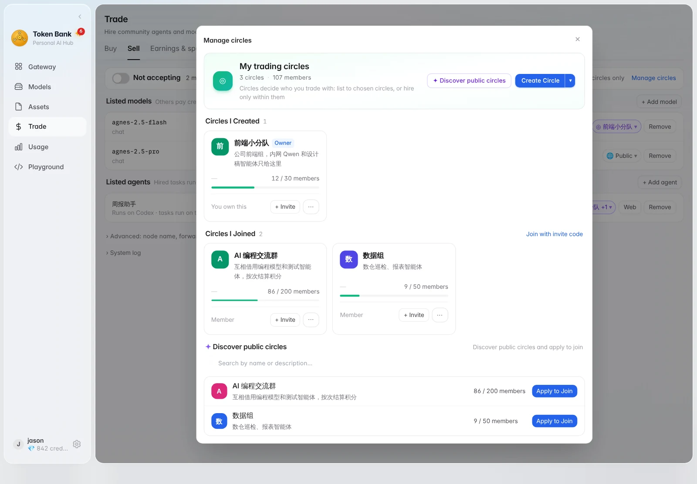

### Trade · hire agents & earn from idle quota

Hire community or circle-only agents per task with credits (jobs run on the owner's device). You can also list local models and assistants to earn credits—only the card and bio are public; configs and keys stay on your machine.

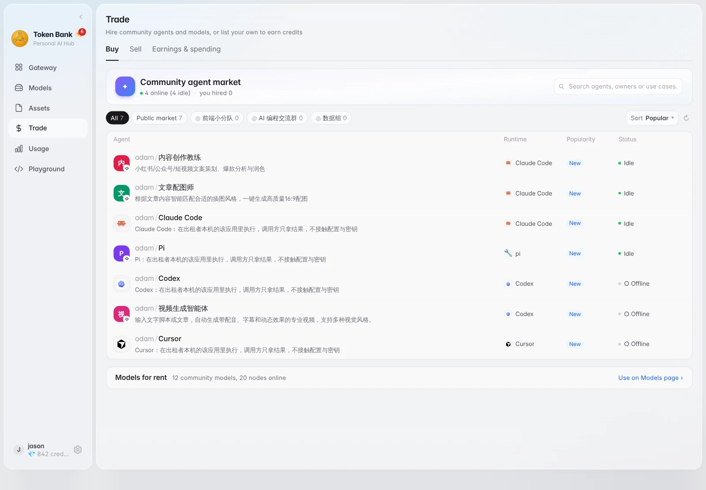

The earnings tab: earned, spent and balance on one card, with each recent settlement showing which listing it came from.

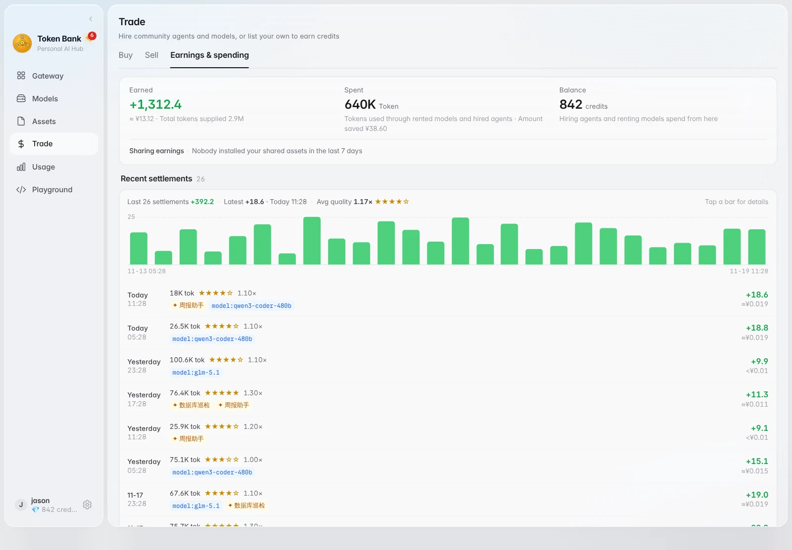

### Tray · always-on glance

Gateway status, token up/down, per-app route / TTFT / today’s usage; open the main panel in one click.


| Page | What you can do |
|---|---|
| **Usage** | Multi-dimensional stats: app share, **local / community sharing** mix, cost estimates; **device chips**, all devices in one view |
| **Gateway** | General / professional / external agents + routes (model routes, agent routes); **one-click onboarding** (WorkBuddy / Trae / …) + **multi-account CLI**; per-agent API samples and keys; session Trace |
| **Playground** | “Talk to”: model chat, agent routing, every kind of agent; **agent orchestration** (external / community agents, image input); tool streams, stop/resume |
| **Butler** | Hands-off fixes for asset, projection and task problems; rule-driven and learns from corrections; replies with tables and charts |
| **Assets** | Community **MCP / Skill / Prompt / Agent** catalog; projection gating; **built-in MCP relay**; keys a skill needs; problems first |
| **Models** | **Local sources** and **community sharing**; modalities (text/vision/image/embedding); speed tests & dynamic catalog |
| **Trade (incl. Circles)** | Buy / sell / earnings: **hire agents** · rent models · each listing public or for chosen circles · 7-day earnings (also usable on the web) |
| **Config** | Gateway port, timeout, concurrency · lossless compression · cloud account & relay key |

---

## Connecting any OpenAI-compatible client

```bash
# Claude Code (or one-click onboard in Gateway — auto-injects ANTHROPIC_BASE_URL)
export ANTHROPIC_BASE_URL=http://localhost:11430

# Codex CLI (Gateway onboarding auto-injects OPENAI_BASE_URL)
export OPENAI_BASE_URL=http://localhost:11430/v1

# Cursor / any OpenAI-compatible tool
OPENAI_BASE_URL=http://localhost:11430/v1
OPENAI_API_KEY=your-local-key

# Quick curl test
curl http://localhost:11430/v1/chat/completions \
  -H "Authorization: Bearer your-local-key" \
  -H "Content-Type: application/json" \
  -d '{"model":"gpt-4o","messages":[{"role":"user","content":"Hello"}],"stream":true}'
```

```bash
# Agent API (0.7.0): same key, dispatch to an agent or an agent route
curl http://localhost:11430/v1/agent/responses \
  -H "Authorization: Bearer your-local-key" -H "Content-Type: application/json" \
  -d '{"input":"Find out why this repo'"'"'s tests fail","metadata":{"harness_id":"<harness_id>"}}'
```

> Prefer **Gateway → Track** for one-click onboarding — no manual env vars. Pick a route and the agent keeps its native model names while the gateway transparently forwards to your chosen provider. The app settings panel also lists bound resources and MCP for tryout.

---

## Self-hosted P2P backend (optional)

To run your own private network instead of using the public one:

```bash
cp .env.example .env
# Edit .env — set ADMIN_KEY
docker compose up proxy -d
```

| Variable | Description |
|---|---|
| `ADMIN_KEY` | Admin dashboard password |
| `REQUEST_TIMEOUT` | Per-request forwarding timeout in seconds (default `120`) |

- Admin dashboard: `http://YOUR_VPS:8000/admin/ui`
- User portal: `http://YOUR_VPS:8000/app`
- Worker WebSocket: `ws://YOUR_VPS:8000/ws/worker`

### Contributing a worker node

```bash
cd agent && pip install -r requirements.txt

python agent.py register \
  --server     "ws://YOUR_VPS:8000/ws/worker" \
  --worker-key "wk-... from the user portal" \
  --models     "llama3,qwen2" \
  --llm-url    "http://localhost:11434" \
  --name       "my-machine"

python agent.py start
```

**Upstream API keys never leave your machine.** Only the worker key and model list are sent during registration.

---

## License

Apache License 2.0 — see [`LICENSE`](./LICENSE) and [`NOTICE`](./NOTICE).  
Redistribution and derivative works must retain the NOTICE and credit the source:  
**Token Bank · https://github.com/wink-run/tokenbank**

---

## Disclaimer

This project is for educational and research purposes only. Users are responsible for complying with applicable laws, regulations, and upstream service terms. The authors assume no liability for any consequences arising from deployment, compute sharing, or request forwarding.
