# Token Bank

> ## Your AI needs a manager.
>
> **Personal AI hub · Your token manager.** One local gateway for Claude Code, Codex, Cursor, WorkBuddy, Kimi Code and more — see every token, spend less, keep every AI asset in one place, orchestrate agents, and rent out what sits idle.
>
> Open source · Keep your workflow · One-click revert

[Website](https://tokenbank.wink.run) · [Free download](https://github.com/wink-run/tokenbank/releases/latest) · [▶ Watch on YouTube](https://www.youtube.com/watch?v=AYLIdneVEgc) · [中文文档](./README.zh-CN.md) · [Architecture](./DESIGN.md) · [Privacy Policy](./docs/PRIVACY_POLICY.md)


---

## Overview

**Token Bank is a next-generation personal AI resource hub** that enables one-click onboarding and intelligent orchestration of mainstream AI tools like Claude, Cursor, Codex, and WorkBuddy through a local gateway architecture.

### Core Value Proposition

- **Usage Transparency**: Full-chain trace makes every token consumption accountable
- **Cost Optimization**: Smart routing automatically switches between local models, free quotas, paid subscriptions, and community-shared compute with lossless protocol adaptation
- **Sharing Economy**: P2P compute-sharing network creates a decentralized exchange for models and agents, monetizing idle resources into credits

### Technical Highlights

**Zero-Intrusion Integration**  
Declarative application handlers (CLI env injection + config hot-patching) enable seamless onboarding without modifying agent applications.

**Multi-Protocol Adaptation Layer**  
Transparent protocol conversion (Anthropic Messages, OpenAI Chat, Codex Responses) allows agents to use third-party models without awareness.

**Unified Asset Layer Architecture**  
Community agents run directly on users' existing agent applications (Codex, Claude, Cursor, etc.) without rebuilding harnesses, executing within user-accumulated MCP/Skill/Prompt assets for dual reuse of runtimes and tool ecosystems.

**Scenario Routing Engine**  
- Routing policy learning from usage patterns
- Lossless context compression
- Vision enhancement layer for non-multimodal models (automatic image recognition injection)

**MCP Built-in Relay & Resource Projection Gating**  
Constructs personal knowledge and tool ecosystems with controlled resource deployment.

**AI-Native Architecture**  
Abandons traditional hard-coded rules; lets agents dynamically construct core capabilities (asset discovery, personalized recommendations, routing optimization) based on actual scenarios and continuously evolve—building an agent management platform with agents—achieving high flexibility and robustness.

**Usage-Based Evolution**  
The system automatically extracts work portraits from real call records and session patterns, driving personalized recommendations for MCP/Skill/Prompt/Agent and continuous optimization of routing strategies. Multi-device usage aggregation, agent orchestration, and more make Token Bank truly **smarter with you**.

---

## Why Token Bank

**Six AI headaches. One hub.**

| Sound familiar? | What Token Bank does |
|---|---|
| **Too many AI tools** — each configured differently, switched by hand | **One-click onboarding**: every tool behind one local address; revert to the official config anytime |
| **Bills keep growing** — no idea where the tokens went | **Full-chain trace**: app, model, tokens and cost for every call, merged across devices |
| **Quota expires unused** — free tiers idle while paid usage climbs | **Smart routing**: local and free sources first, native model names unchanged, protocols converted automatically |
| **Skills & MCPs everywhere** — copy-pasted, out of sync | **AI assets in one place**: MCP / Skill / Prompt / Agent in one library, projected to the agents that need them |
| **Top models out of reach** — rare models and expert agents feel unreachable | **Sharing market**: pay per call in credits to use rare models or hire expert agents |
| **Idle capacity wasted** — unused subscriptions, local models gathering dust | **Earn from idle**: rent out models and agents for credits — API keys, Skills and configs never leave your machine |

**Token Bank is your personal AI hub — your AI's manager.** Plug Claude Code, Codex, Cursor, WorkBuddy, Kimi Code and more into one local gateway without changing how you work: **see clearly, spend less, stay simple**, keep your AI assets in order and let them **get smarter with you**, orchestrate a team of agents from one sentence, and **earn from idle** by renting out what you don't use.

**Five pillars:**

| Pillar | What you get |
|---|---|
| **See clearly** | One-click onboard; full trace; multi-device analytics; subscriptions vs PAYG side by side |
| **Spend less** | Seamless model swap; smart local-first + task-type routing; scene strategies; optional lossless compression |
| **Stay simple** | One-click onboard/restore; all AI assets in one library, projected to every agent; multi-account CLI by directory; tray status; one local address |
| **Get smarter with you** | Work portrait; personalized MCP / Skill / Prompt / Agent discover · accumulate · iterate |
| **Earn from idle** | Rent out idle models and agents for credits (keys and Skills stay local); rent rare models or hire expert agents per call; circles & network map |

---

## Architecture

```
┌─────────────────────────────────────────────────────────────────┐
│  Desktop (Electron · Mac / Windows) or CLI / Docker Web UI      │
│  Gateway · Models · Assets · Playground · Usage · …          │
└────────────────────────────┬────────────────────────────────────┘
                             │ loopback
                             ▼
┌─────────────────────────────────────────────────────────────────┐
│  Local gateway  :11430/v1                                       │
│  · Anthropic Messages / OpenAI Chat / Codex Responses adapters  │
│  · keyScene rewrite · scene/task-type routing · compression     │
│  · Built-in MCP relay (prompts / models / resources / bridge)   │
└───────────────┬─────────────────────────────┬───────────────────┘
                │ local keys stay on device     │ login + relay key
                ▼                             ▼
     Ollama / free API / sub / PAYG      Token Bank cloud
                                             │
                              ┌──────────────┼──────────────┐
                              ▼              ▼              ▼
                         Community P2P   Remote agents   Multi-device
                         (WebSocket)     (run elsewhere) usage merge
```

**Implementation notes:**

| Layer | What it does |
|---|---|
| **App handlers** | Declarative `app-handlers.yaml` for CLI shim / config-file patch / session scan; WorkBuddy, Trae, Hermes, Kimi use strong install signals |
| **Routing** | Unified “route = selector chain”: personal/community/free/paid filters + task-type presets (`design` / `repo-qa` / `chore` / `debug`) |
| **Resource projection** | Skill / Prompt / MCP only onto **hosted and installed** targets; apps without stdio use the built-in MCP relay |
| **Telemetry** | Live gateway logs + local session import (Claude / Codex / Cursor / WorkBuddy Trace, …) with auto-dedupe |

---

## Core capabilities: one-click onboarding · seamless model swap · full trace

Token Bank is more than an API proxy — it brings **Claude Code, Codex, Cursor, WorkBuddy, Kimi Code, OpenClaw**, and other mainstream agents under one local gateway. **No agent-side changes required** for usage tracing, third-party model switching, and smart routing.

### One-click agent onboarding

Open the **Gateway** tab — installed tools appear automatically (desktop apps can be added manually):

| Agent | How it connects |
|---|---|
| Claude Code / Codex CLI / OpenCode / Hermes / Kimi Code | CLI shim: injects `BASE_URL` (and related) env vars — no command changes |
| Claude Desktop / Codex Desktop / OpenClaw / WorkBuddy | Config-file patch: one click to point at the local gateway (missing configs may be created after strong install detection) |
| Trae Work | Session import + manual gateway params inside the IDE |
| Cursor / Copilot / Qwen / Grok / … | Session stats, or set `OPENAI_BASE_URL` / a dedicated Gateway key |

**Onboarding flow:**

1. Click **Track** → start counting that app's token usage (even on the official subscription)
2. Pick a **model or scene route** in the dropdown → config is rewritten automatically; traffic goes through the gateway
3. Click **Revert** → restore the official config and stop tracking

Three states, clearly separated: **stats only** (official sub + session import), **via gateway** (route bound + live proxy), **reverted** (original config restored).

### Seamless third-party model switching

Agents keep their native model names (`claude-sonnet-4-6`, `gpt-5`, …). **The client never needs to change:**

```
Claude Code requests claude-sonnet-4-6
        ↓  gateway keyScene transparent rewrite
Actually routed → Groq llama-3.3-70b / local Ollama / DeepSeek / …
        ↓  protocol adapter
Anthropic Messages ↔ OpenAI Chat ↔ Codex Responses
```

- **Model names unchanged** — Claude client validation and UI stay the same
- **Automatic protocol conversion** — `/v1/messages`, `/v1/chat/completions`, `/v1/responses` each handled
- **Per-app bindings** — Claude Code on free Groq, Codex on local Ollama, independently
- **Switch back anytime** — choose "Direct (official)" in the route dropdown; config is restored cleanly

### Session trace (live proxy + session import)

Usage is traced whether or not traffic goes through the gateway:

| Mode | What it does |
|---|---|
| **Live proxy** | Requests via `localhost:11430` — logs route chain, resolved model, tokens, latency, cost |
| **Session import** | Tracked apps that still hit the official API — local session logs (`~/.claude`, `~/.codex`, WorkBuddy Trace, …) are scanned and imported |
| **Dedup** | Same call recorded by both gateway and session file → counted once |

Trace data appears on the **Dashboard** sliced by **app · provider · model · supply type · device · time**; the call log shows route result and latency per request.

### Smart routing

Supply is organized into **local sources** and **community sharing sources**. Each app can bind its own route; a global supply chain acts as fallback:

```
Per-app binding (keyScene / scene routes / task-type routes)
    ↓ unbound or llm-router-* model
Smart supply chain (unified “route = selector chain”)
    Local: Ollama → free API (Groq / GitHub Models) → subscription / PAYG API
    ↓ local unavailable or need extra compute
    Community sharing (spend credits on shared community compute)
    ↓ policy groups
fallback · round-robin · weighted · latency · direct
```

| Supply type | Includes | Notes |
|---|---|---|
| **Local sources** | Ollama, free API, APP/API subscriptions, pay-as-you-go | Forwarded by your local gateway; keys never leave the machine |
| **Community sharing** | Shared community compute network | Spend credits on remote nodes; model list synced dynamically |

- **Scene routes** — daily chat, code completion, long-doc analysis each get their own chain
- **Task-type routes** — presets like `design` / `repo-qa` / `chore` / `debug` (OpenCode-style inference routing)
- **Scope / price filters** — personal-only, community-only, free-only, or paid-only
- **Policy groups** — pick provider order from task features (tool calls, context length, …)
- **Failover** — local source down? try community sharing automatically; fully transparent to the agent
- **Egress guards** — clamp outbound `max_tokens` to upstream limits to cut avoidable 400s

### Model modalities

Provider models can be tagged **text / vision / image-gen / embedding**, driving Playground capabilities and Codex catalog `input_modalities` (vision models expose image input).

### Gateway lossless compression

Optional **lossless JSON compression** before forwarding — fewer input tokens upstream, **semantics unchanged**:

- Minifies pretty-printed JSON in messages (tool results, embedded data); strips whitespace only
- Non-JSON content is left byte-for-byte untouched — answers stay the same
- Enable in **Config**, or set `TOKENBANK_COMPRESS=1`
- **Dashboard** shows compression count, tokens saved, and ratio; cloud merge across devices when signed in

### Multi-device usage aggregation

Desktop, CLI, and server gateways each register as a device — **usage is reported and merged in the cloud** when signed in:

| Capability | What it does |
|---|---|
| **Device registration** | Each machine gets a persistent device_id; 60s heartbeat tracks online status |
| **Inventory snapshots** | Reports calls, tokens, cost, local / community sharing mix, top models/apps for 1 / 7 / 30 day windows |
| **Cloud merge** | **Profile** and **Dashboard** show per-device share, online status, detail vs aggregate views |
| **Cross-device sync** | Subscriptions, PAYG config, and tool lists sync on login — no re-setup when switching machines |

### Unified subscription management

The **Profile** tab is the single hub for all billing accounts; **Models** handles keys and routing:

| Type | How it's managed | Typical use |
|---|---|---|
| **APP subscription** | Register ChatGPT / Claude / Gemini / Cursor plans and monthly cost | Stats-only on official sub, or OAuth → API gateway |
| **API subscription** | Separate catalog for vendor API plans (e.g. Volcengine Coding Plan) | API Key gateway, billed separately from APP subs |
| **Pay-as-you-go** | Register providers, model lists, and USD/M-token list prices | The Models page only exposes models configured here; cost estimates use these rates |

- **Cloud sync** — subscriptions and PAYG config download on login; Mac / Windows / Linux stay in sync
- **Billing overlay** — daily subscription amortization + PAYG estimates alongside raw token stats
- **Supply linkage** — Profile defines *what you use and what it costs*; Models defines *how to connect and route*

### Dynamic supply delivery

Local source catalogs and tool lists don't require manual version bumps — **sync on login, refresh when online**:

```
Server-maintained
    ├── Local source catalog (Ollama / Groq / GitHub Models / SiliconFlow …)
    ├── Tool list config.apps (agent onboarding rules, protocol adapters)
    └── Scene routes config.scenes (preset routing chains)
         ↓  auto-fetched on login / startup
Local gateway
    ├── Merged into ~/.tokenbank/tokenbank.yaml
    ├── Community sharing online models refreshed periodically (/v1/models → route candidates)
    └── One-click env scan — import existing free keys with round-robin
```

- **Local catalog delivery** — Groq, Cerebras, GitHub Models, NVIDIA NIM, etc. listed under **Local sources**; admins hot-update via YAML upload
- **Community sharing models** — online contributor models pulled live; no manual local registration
- **Env scan** — one-click import of existing Groq / GitHub Models / Anthropic keys; multi-key round-robin
- **Offline fallback** — built-in defaults when offline; server deltas merged automatically when back online

### Multi-account CLI & directory dispatch

Run multiple logins of the same CLI (Claude Code / Codex). The gateway picks the right instance by **working directory** so configs never collide:

| Capability | What it does |
|---|---|
| **Auto-scan** | Discover existing CLI account instances on startup or manual rescan |
| **Manual add** | Gateway → “CLI instance” for accounts the scanner misses |
| **Effective directory** | Bind each instance to a workdir; the shim injects env from `$PWD` |
| **Quota visibility** | Claude / Codex subscription meters; tray and app list show today’s usage |

### Agent orchestration (Playground)

**Debug / Playground** is more than a single-model chat:

- Set a **main agent** as the aggregation entry for natural-language tasks (**image input** supported)
- The main agent can plan steps and dispatch to other onboarded agents (including Kimi / Cursor runtimes)
- **Community agents**: hire on demand from the Trade page; tasks run on **their device**, without downloading their source — lower risk than running unknown agents locally
- Built-in `tokenbank-agent-bridge` MCP: `tb_list_agents` / `tb_dispatch_agent` for orchestration
- Chunked conversation stream, visible tool calls, stop then continue
- Agent visibility is gated by **runtime projection + hosted install** — only projected, available agents appear

### AI assets in one place: MCP · Skill · Prompt · Agent

Skills in one folder, MCP configs in three, prompts in a text file you can't find — the **Assets** tab gathers community picks and your own assets into one ordered library, and **projects** them to every agent instead of copying them around. Edit once, and every managed agent gets the same version.

| Type | Capability |
|---|---|
| **Community catalog** | Sync recommended MCP / Skill / Prompt / Agent lists on login (cache-first, built-in offline fallback) |
| **Projection** | Project only onto **hosted and installed** targets; revoke anytime; cascade deps on onboard |
| **Built-in MCP relay** | For apps without stdio: pick app → bind prompts/models/resources → copy relay config |
| **Prompt MCP** | Prompts served via `tokenbank-prompts` (`tb_get_prompt` / `tb_list_prompts`) filtered by projection set |
| **Work-portrait posters** | Dashboard can export four poster styles (pro / cute / humor / minimal) |

---

## Five things it does

### 1 — See clearly

Token Bank logs every request: which route it took, which model answered, how many tokens, how long it took.

- **One-click onboard & inventory**: stats-only / via gateway / restore; per-app calls, tokens, cost
- **Full trace**: live proxy + session import with auto-dedupe
- **Multi-device analytics**: app · provider · model · cost · device · time; cloud merge when signed in
- **Subscriptions vs PAYG**: APP / API / metered side by side with daily accrual and list-price estimates

### 2 — Spend less

A **smart local-first routing chain**, with community sharing as fallback:

```
Local: Ollama → free APIs → subscription / PAYG
    ↓ unavailable or need extra capacity
Community sharing (spend credits on shared compute)
```

- **Seamless model swap**: native model names unchanged; protocols adapted automatically (including Codex Responses tool forwarding)
- **Scene / task-type strategies**: chat / completion / long docs / design·repo-qa·chore·debug; failover transparent to agents
- **Lossless compression**: fewer upstream input tokens, meaning unchanged

### 3 — Stay simple

- **One-click onboard/restore** on the Gateway page
- **Multi-account CLI** by working directory; menu-bar tray for status and today’s usage (brand logo + glass popover)
- **OpenAI-compatible endpoint**: point existing tools at one local address
- **Playground orchestration**: main agent takes tasks and hands off (including community agents); tool streams visible

### 4 — Get smarter with you

- **Work portrait** mined from real calls and habits; reusable across skills, prompts, agents
- **For You**: personalized MCP / Skill / Prompt / Agent discovery
- **Accumulate & iterate**: keep assets in your library; reuse portrait to rediscover, or remine; compose when the catalog falls short

### 5 — Earn from idle

**Rent out idle AI. Rent rare AI.** The sharing market has two sides, both inside the same gateway:

| | Lender (your device) | Renter (community user) |
|---|---|---|
| **What** | List idle subscription quota, local or private models, and projected agents | Call rare or private models, or hire expert agents by the task |
| **Privacy** | Only a public card is shown; **API keys, Skills, Prompts and configs never leave your machine**; jobs run locally and only results go back | Nothing of theirs lands on your machine — you only receive results |
| **Credits** | Every call earns credits (outbound connection, no open ports) | Pay per call in credits — no extra subscription needed |

Contribute unused compute or API quota to **community sharing**, earn credits, spend them on shared models; or **list / hire agents** (tasks run on their device; configs and API keys stay local).

**You can contribute compute:** local Ollama, unused upstream quota, private LAN models (outbound WebSocket—no inbound port)

```
credits = (output_tokens / 1000) × contribute_rate × quality_multiplier (0.5–1.5)
spend   = ((prompt + completion tokens) / 1000) × consume_rate
```

Contribute rate > consume rate; plus check-in, wheel, and referrals. Circles share models and credits.

**Hire agents:** On the Trade page, list projected assistants (card/bio only) or hire community agents per use; jobs run on their device without downloading their source; shareable landing pages for tryouts. Launch from Playground or a hosted app.

---

## Quick start

### Desktop app (Mac / Windows — recommended)

Download the installer from [Releases](https://github.com/wink-run/tokenbank/releases/latest):

- **macOS** `.dmg` — double-click to install, lives in the menu bar, auto-updates
- **Windows** `.exe` — NSIS installer, auto-updates; title bar matches the app shell theme

After installing: open the app → go to **Config** → enter your backend URL and relay API key → done.

**Point your AI tools at the local gateway:**

```
OPENAI_BASE_URL=http://localhost:11430/v1
```

Create a local API key in the **Gateway** tab, or use an existing upstream key.

---

### CLI mode (Linux / servers)

```bash
git clone https://github.com/wink-run/tokenbank.git
cd tokenbank/client
npm install
node cli/gateway.js start
```

Open `http://localhost:11431` in a browser to configure. Works identically to the desktop app.

```bash
# Background (nohup)
nohup node cli/gateway.js start > gateway.log 2>&1 &

# Or with pm2
pm2 start cli/gateway.js -- start
```

---

### Docker (containerised)

```bash
git clone https://github.com/wink-run/tokenbank.git
cd tokenbank

# 使用部署脚本（推荐）
./deploy.sh gateway

# 或直接使用 docker compose
docker compose --profile gateway up -d
```

The `gateway-data/` volume is mounted automatically; **`local-config.json` is created on first start**. Configure routes and apps in the Web UI on `:11431`. See [`gateway-data/README.md`](./gateway-data/README.md).

| Port | Purpose |
|---|---|
| `11430` | LLM requests (`OPENAI_BASE_URL=http://host:11430/v1`) |
| `11431` | Web management UI |

**独立部署：** Token Bank 支持分别部署服务端和 Gateway，避免不必要的重建。详见 [DEPLOY.md](./DEPLOY.md)。

```bash
# 仅部署服务端
./deploy.sh server --https

# 仅部署 Gateway
./deploy.sh gateway

# 仅更新服务端（不重启数据库和 Gateway）
./deploy.sh server --no-deps

# 仅更新 Gateway（不影响服务端）
./deploy.sh gateway --no-deps
```

---

## What's in the UI

### Gateway · one-click onboarding & scene routes

Every AI app in one list with today's requests, tokens and last use; bind each app to a scene route (Coding / Speed first / Free sources…). The App toolbox installs / removes Claude Code, Kimi Code, Cursor, Codex, and more.

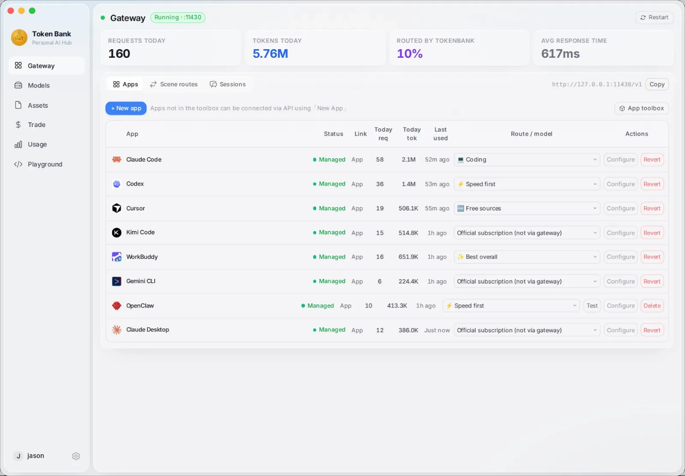

### Sessions · unified cross-app trace

Filter by Claude Desktop / Cursor / Kimi Code / Codex, inspect tokens and cost, hand off or export.

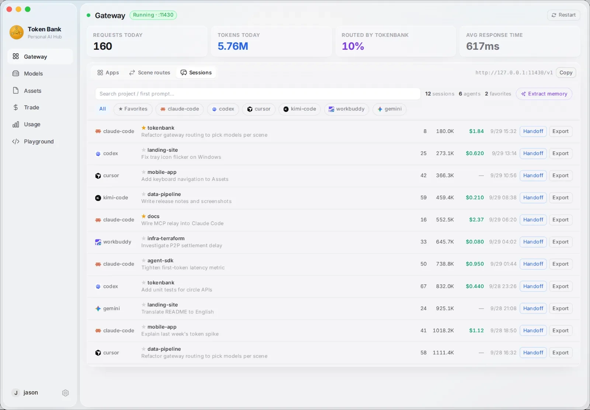

### Session Trace · step-level observability

Per-session steps, tool calls, skills used, and token breakdown (sealed reasoning when required by the API).

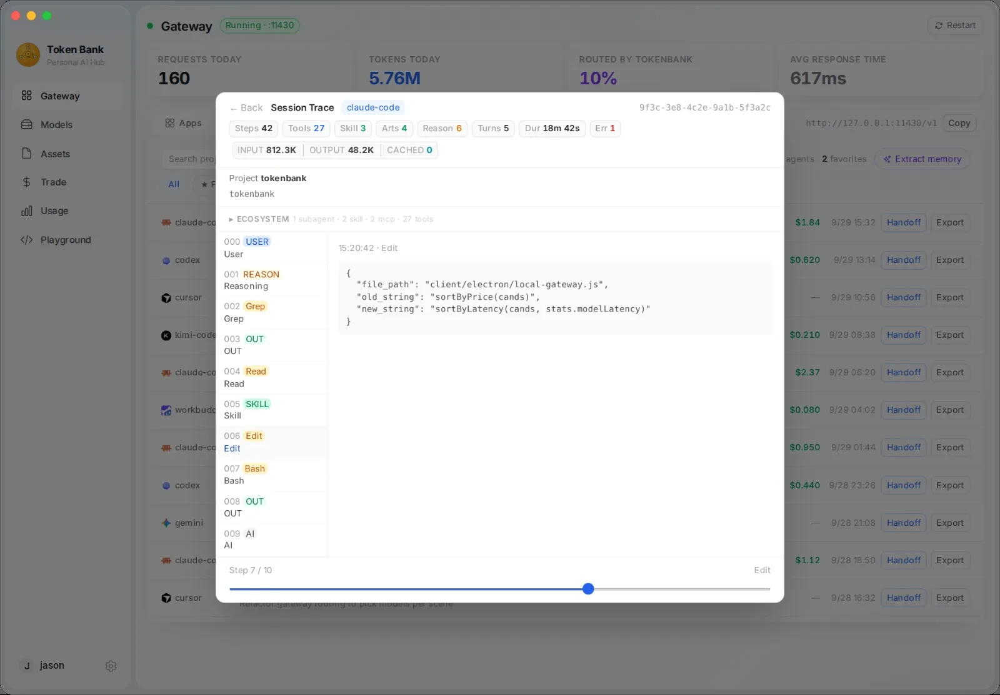

### Models · personal compute + community sharing

Speed-test personal models with status lights; spend credits on community-shared models.

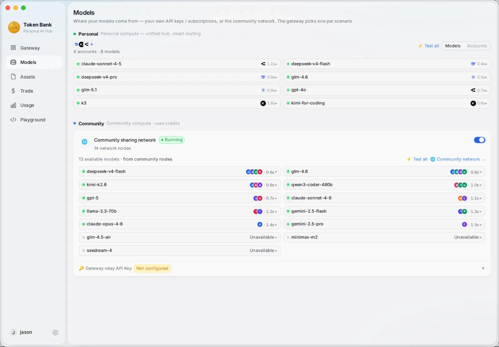

### Assets · Agents / Skills / Prompts

Prompts, skills, agents and MCP tools managed in one place and projected onto runtime CLIs in one click; **Discover** mines a work portrait from your sessions for “For you” picks and community favorites.

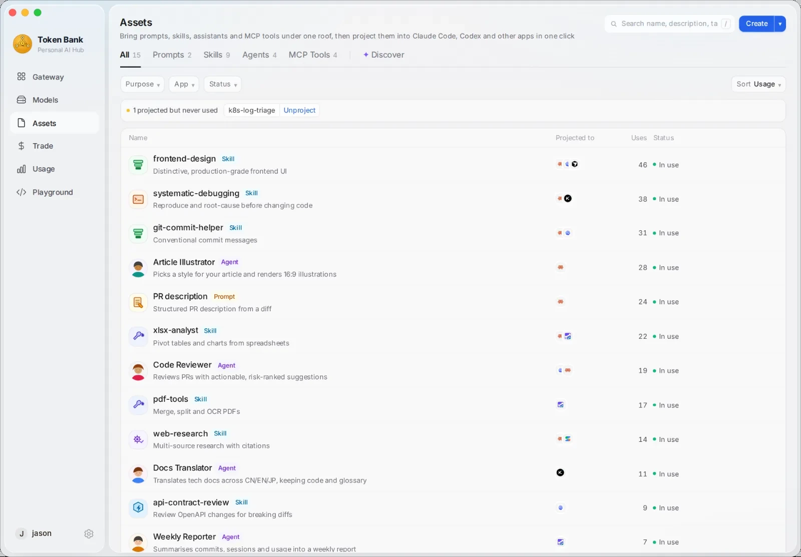

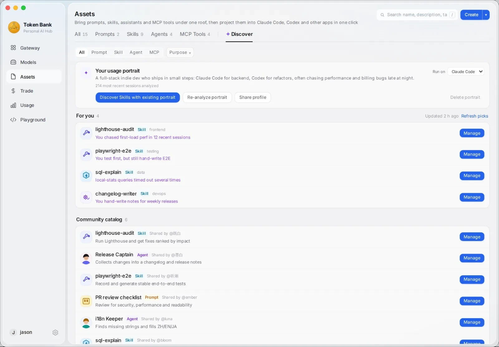

### Playground · agent orchestration

The main agent takes the task, runs tools, and dispatches sub-tasks in parallel to other agents such as Codex / Kimi Code; pick runtimes and managed agents on the left.

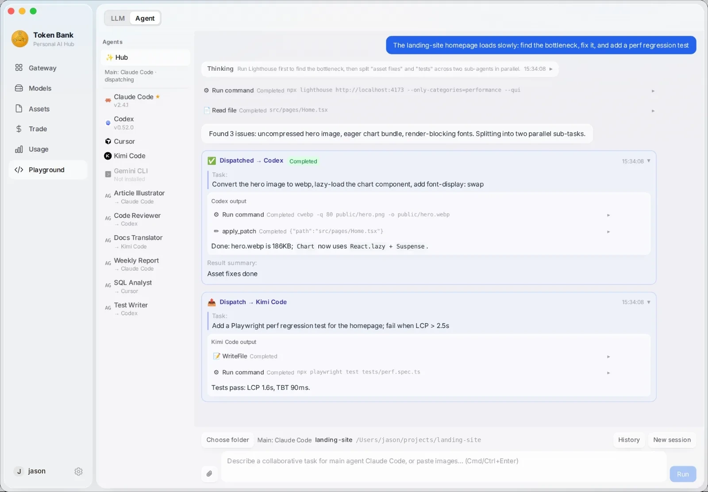

### Usage · spend visibility

Requests / tokens / free-hit rate / estimated cost (subscriptions prorated daily + pay-as-you-go); per-app mix and 7-day trend.

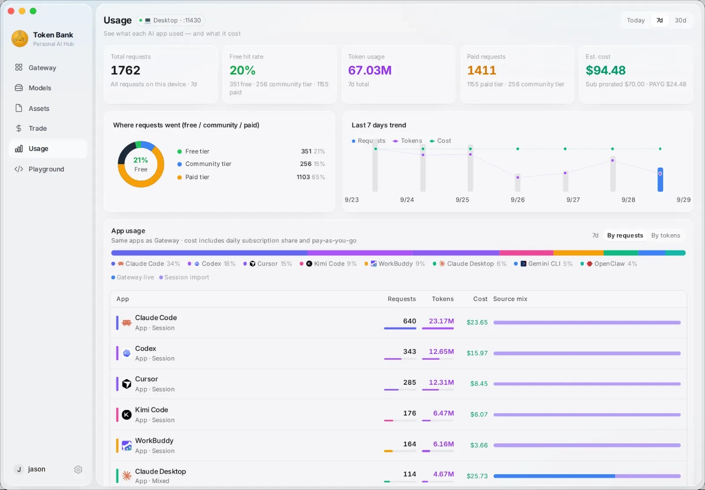

### Circles · trade only with people you trust

Circles are the scope of trading: create or join one under **Trade → Circles**, list supply to chosen circles, and filter hiring to circle-only agents. Inviting friends earns both sides credits.

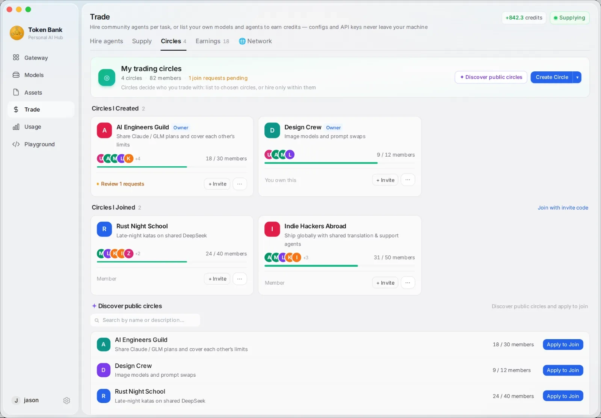

### Trade · hire agents & earn from idle quota

Hire community or circle-only agents per task with credits (jobs run on the owner's device). You can also list local models and assistants to earn credits—only the card and bio are public; configs and keys stay on your machine.

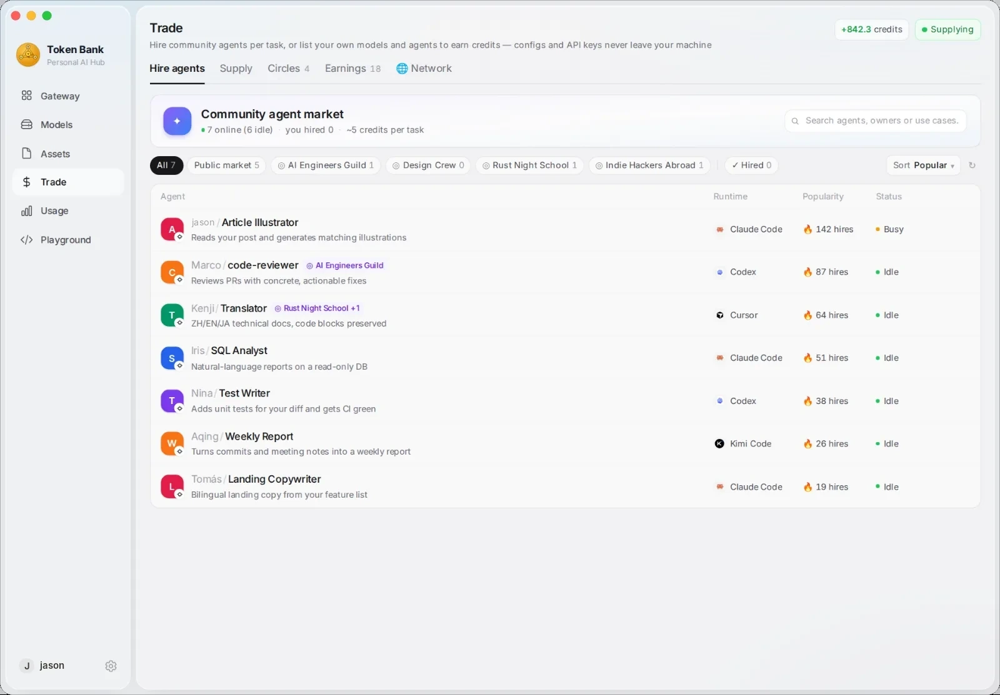

### Community network · node map

Under **Trade → Network**: online nodes, available models and agents, geographic distribution, and a supply leaderboard.

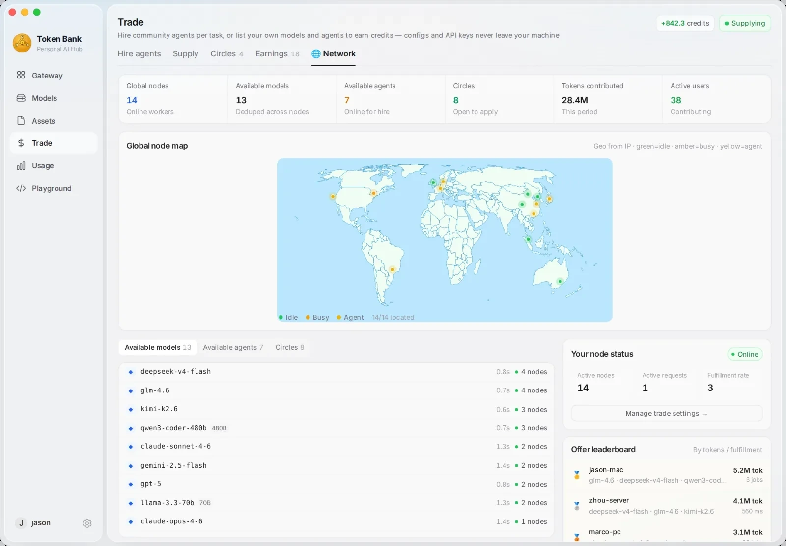

### Tray · always-on glance

Gateway status, token up/down, per-app route / TTFT / today’s usage; open the main panel in one click.


| Page | What you can do |
|---|---|
| **Usage** | Multi-dimensional stats: app share, **local / community sharing** mix, cost estimates; **work-portrait posters** |
| **Gateway** | **One-click onboarding** (WorkBuddy / Trae / …) + **multi-account CLI**; session Trace; scene / task-type routes |
| **Playground** | **Agent orchestration** (community agents, image input); tool streams, stop/resume |
| **Assets** | Community **MCP / Skill / Prompt / Agent** catalog; projection gating; **built-in MCP relay**; portrait recommendations |
| **Models** | **Local sources** and **community sharing**; modalities (text/vision/image/embedding); speed tests & dynamic catalog |
| **Trade (incl. Circles) / Network** | **Hire agents** · list supply · circles as trade scope / community network map (also usable on the web) |
| **Config** | Gateway port, timeout, concurrency · lossless compression · cloud account & relay key |

---

## Connecting any OpenAI-compatible client

```bash
# Claude Code (or one-click onboard in Gateway — auto-injects ANTHROPIC_BASE_URL)
export ANTHROPIC_BASE_URL=http://localhost:11430

# Codex CLI (Gateway onboarding auto-injects OPENAI_BASE_URL)
export OPENAI_BASE_URL=http://localhost:11430/v1

# Cursor / any OpenAI-compatible tool
OPENAI_BASE_URL=http://localhost:11430/v1
OPENAI_API_KEY=your-local-key

# Quick curl test
curl http://localhost:11430/v1/chat/completions \
  -H "Authorization: Bearer your-local-key" \
  -H "Content-Type: application/json" \
  -d '{"model":"gpt-4o","messages":[{"role":"user","content":"Hello"}],"stream":true}'
```

> Prefer **Gateway → Track** for one-click onboarding — no manual env vars. Pick a route and the agent keeps its native model names while the gateway transparently forwards to your chosen provider. The app settings panel also lists bound resources and MCP for tryout.

---

## Self-hosted P2P backend (optional)

To run your own private network instead of using the public one:

```bash
cp .env.example .env
# Edit .env — set ADMIN_KEY
docker compose up proxy -d
```

| Variable | Description |
|---|---|
| `ADMIN_KEY` | Admin dashboard password |
| `REQUEST_TIMEOUT` | Per-request forwarding timeout in seconds (default `120`) |

- Admin dashboard: `http://YOUR_VPS:8000/admin/ui`
- User portal: `http://YOUR_VPS:8000/app`
- Worker WebSocket: `ws://YOUR_VPS:8000/ws/worker`

### Contributing a worker node

```bash
cd agent && pip install -r requirements.txt

python agent.py register \
  --server     "ws://YOUR_VPS:8000/ws/worker" \
  --worker-key "wk-... from the user portal" \
  --models     "llama3,qwen2" \
  --llm-url    "http://localhost:11434" \
  --name       "my-machine"

python agent.py start
```

**Upstream API keys never leave your machine.** Only the worker key and model list are sent during registration.

---

## License

Apache License 2.0 — see [`LICENSE`](./LICENSE) and [`NOTICE`](./NOTICE).  
Redistribution and derivative works must retain the NOTICE and credit the source:  
**Token Bank · https://github.com/wink-run/tokenbank**

---

## Disclaimer

This project is for educational and research purposes only. Users are responsible for complying with applicable laws, regulations, and upstream service terms. The authors assume no liability for any consequences arising from deployment, compute sharing, or request forwarding.
