# Token Bank

> ## 你的 AI，该有个管家了。
>
> **个人 AI 中枢 · 智能体应用工厂。** 一个本地网关、一把 Key，既调模型，也把任务派给智能体：Claude Code、Codex、Cursor、Kimi Code 等本机应用，你在资产里配好的专业智能体，接进来的外部智能体，还有从社区雇来的智能体。每个 Token 看得清、花得更少；AI 资产一处纳管；出了问题交给智能管家；闲置的模型和智能体还能出租赚钱。
>
> 开源 · 不改使用习惯 · 随时一键还原 · 桌面版 / 命令行 / Docker 网页版

[官网](https://tokenbank.wink.run) · [免费下载](https://github.com/wink-run/tokenbank/releases/latest) · [▶ YouTube 观看](https://www.youtube.com/watch?v=AYLIdneVEgc) · [English](./README.md) · [架构文档](./DESIGN.md) · [隐私政策](./docs/PRIVACY_POLICY.md)

<iframe width="560" height="315" src="https://www.youtube.com/embed/AYLIdneVEgc?si=d2wfuuvXrKem73oy" title="YouTube video player" frameborder="0" allow="accelerometer; autoplay; clipboard-write; encrypted-media; gyroscope; picture-in-picture; web-share" referrerpolicy="strict-origin-when-cross-origin" allowfullscreen></iframe>

---

## 0.7.0：从「模型网关」到「智能体应用工厂」

0.6 及以前，Token Bank 的重心在**模型这一层**：把 AI 应用纳管进本地网关，换模型、走路由、看清每个 Token。

0.7.0 把**智能体**也变成了一等公民。同一个网关、同一把 Key，既能调模型，也能把任务派给智能体。网关之上，运行时、资产、接口、观测、分发五层也都搭好了，加上底下的模型层，一共六层现成能力。你可以直接在最上面做自己的应用，不用再从零写 harness、计费和网页。

| 0.7.0 更新 | 你得到什么 |
|---|---|
| **全新界面** | 打开网关、模型、资产、盘点或交易，先看到现在的状态，要改再点进去 |
| **API 统一** | 同一把网关 Key、同一套地址，调模型也派智能体；每个智能体还能单独发一把 Key |
| **外部智能体** | Muse、GrokBot 这类在别处运行的智能体用配对码接进来，你派活，它们做完送回 |
| **智能管家** | 资产、投射、任务出了问题交给管家：能修的当场修好，要你决定的才来问 |
| **Docker 完整桌面版** | 在服务器上打开浏览器，用到的就是和桌面版一样的网关、资产、游乐场和会话 |
| **网页版与雇佣市场** | 分享出去的智能体有自己的网页名片，别人打开链接就能雇；上架时每一项单独选公开或只给哪些圈子 |

同一版里还有：技能要用的 Key 在资产页直接配；盘点页按设备胶囊切换、设备和个人页一致；工具页能登记 MCP、HTTP API 和本地命令；交易页买 / 卖 / 收支三栏，上架每项单独选范围。**去掉了**：工作画像与模型推荐（社区目录改为直接搜索启用）、交易页的「共享网络」入口、管家的定时自省报告——管家不再自己花 Token。

完整说明见 [v0.7.0 发布说明](./client/releases/v0.7.0.md)。

---

**Token Bank 是新一代个人AI资源管理中枢**，通过本地网关架构实现对 Claude、Cursor、Codex、WorkBuddy 等主流 AI 工具的一键纳管与智能调度，核心价值在于**用量透明化**、**成本优化**与**共享交换网络**——全链路 Trace 让每一笔 Token 消耗有据可查，智能路由自动在本地模型、免费额度、付费订阅与社区共享算力间无损切换，并通过 **P2P 算力共享网络**形成模型与智能体的去中心化共享交换网络，闲置资源变现为积分。技术层面通过**声明式应用 Handler**（CLI 环境变量注入 + 配置文件热补丁）实现零侵入接入，多协议适配层（Anthropic Messages、OpenAI Chat、Codex Responses）让 Agent 无感使用第三方模型；**统一资产层架构**使社区智能体可直接运行在客户既有的 agent 应用（Codex、Claude、Cursor 等）上，无需重复构建 harness，在用户沉淀的 MCP/Skill/Prompt 资产中执行，实现运行时与工具生态的双重复用；**场景路由引擎**支持转发策略学习、上下文无损压缩，并可为非多模态模型自动注入图片识别能力（视觉增强层）；通过 **MCP 内置中转**与**资源投射门控**构建个人知识与工具生态。产品采用**AI 原生架构**，摒弃传统硬编码规则，由内置的**智能管家**按规则处理投射修复、资产检查（重复、风险技能、新版本）、安装重试与路由回退，规则不够时才用模型判断，你的每次纠正都沉淀为规则（以智能体管理智能体平台），且管家不会自己花 Token；同时实现多设备用量云端聚合、Agent 聚合编排等能力，成为真正意义上的**越用越懂你的 AI 管家**。

0.7.0 起，网关不只转发模型请求：**统一智能体接口** `/v1/agent` 用同一把 Key 把任务派给四类智能体（本机应用、专业智能体、外部智能体、雇来的智能体），任务可以同步等结果、后台查询或流式返回；**智能体路由**由主智能体读规则、从名单里挑人派发；**外部智能体**通过配对码注册、长轮询取任务、回传结果和主动推送；**智能管家**按你教过的规则处理资产、投射和任务里的问题，雇来的任务先过安全检查。

---

## 为什么需要 Token Bank

**八个 AI 痛点，一个中枢解决。**

| 是不是你？ | Token Bank 怎么解决 |
|---|---|
| **AI 工具越装越多**——配置各管各，切换全靠手改 | **一键纳管**：所有工具接入同一个本地地址，随时一键还原官方配置 |
| **账单越来越长**——Token 花在哪，说不清 | **全链路 Trace**：每次调用的应用、模型、Token、费用，多设备汇总 |
| **额度月底清零**——免费额度闲着，付费却在涨 | **智能路由**：本地和免费来源优先，原生模型名不变，协议自动转换 |
| **Skill / MCP 越装越乱**——复制粘贴，版本对不上 | **AI 资产一处纳管**：MCP / Skill / Prompt / Agent 统一收纳，按需投射到各智能体 |
| **好模型用不起**——稀缺模型、专家智能体，够不着 | **共享市场**：按次消耗积分，用上稀有模型、雇佣专家智能体 |
| **闲置能力白白浪费**——订阅用不完，本地模型吃灰 | **闲置赚钱**：出租模型和智能体赚积分，API Key、Skill 与配置不出本机 |
| **智能体各跑各的**——想接进自己的产品，得自己写 harness、接口和计费 | **统一智能体接口**：一把 Key 调模型和智能体，换 `harness_id` 就换智能体；上架即得网页名片 |
| **出了问题全靠自己查**——技能丢了、投射失效、任务跑不起来 | **智能管家**：能修的当场修好，要你决定的才来问；纠正一次就记住 |

**Token Bank 是你的个人 AI 中枢，也是一座智能体应用工厂。** 把 Claude Code、Codex、Cursor、WorkBuddy、Kimi Code 等接入一个本地网关，使用习惯一点不用改：Token **用的明白、用的节省、用的简单**；AI 资产井井有条，**越用越懂你**；一把 Key 调模型也派智能体，一句话调度一支智能体团队；用不上的模型和智能体租出去，**闲置赚钱**。

**五条主线：**

| 主线 | 你得到什么 |
|---|---|
| **用的明白** | 一键纳管；全链路 Trace；多维盘点与多设备汇总；订阅 / 按量对照 |
| **用的节省** | 无损换模；智能路由（本地源优先 + 任务分型）；场景策略；可选无损压缩 |
| **用的简单** | 纳管 / 还原一键完成；AI 资产一处纳管、投射到各智能体；一把 Key 调模型和智能体；问题交给智能管家；CLI 多账号按目录分发；托盘常驻；改一个本地地址即可接入 |
| **越用越懂你** | 智能管家记住你教过的规则，纠正一次就不再犯；派活偏好越用越准；资产重复、有风险、有新版本自动发现 |
| **闲置赚钱** | 出租闲置模型与智能体赚积分（Key 与 Skill 不出本机）；按次租用稀有模型、雇佣专家智能体；每一项单独选公开或只给哪些圈子 |

---

## 技术架构

```
┌─────────────────────────────────────────────────────────────────┐
│  桌面客户端 (Electron · Mac / Windows) 或 CLI / Docker Web UI    │
│  网关 · 模型 · 资产 · 交易(含圈子) · 盘点 · 游乐场 · 托盘      │
└────────────────────────────┬────────────────────────────────────┘
                             │ 本机 loopback
                             ▼
┌─────────────────────────────────────────────────────────────────┐
│  本地网关  :11430/v1                                            │
│  · Anthropic Messages / OpenAI Chat / Codex Responses 协议适配  │
│  · keyScene 换模 · 场景/任务分型路由 · 无损压缩 · 会话 Trace    │
│  · MCP：内置 tokenbank 工具 + 中转投射的第三方 MCP              │
│  智能体接口  :11430/v1/agent（0.7.0）                           │
│  · 本机应用 / 专业 / 外部 / 雇来的智能体 · 智能体路由           │
│  · 网关 Key 通用 · 每个智能体单独一把 Key · 同步 / 后台 / 流式  │
└───────────────┬─────────────────────────────┬───────────────────┘
                │ 本地源 Key 不出机             │ 登录 + 转发 Key
                ▼                             ▼
     Ollama / 免费 API / 订阅 / 按量      云端 Token Bank 服务
                                             │
                              ┌──────────────┼──────────────┐
                              ▼              ▼              ▼
                         社区模型 P2P    社区智能体派发   多设备用量合并
                         (WebSocket)    (对方设备执行)   圈子 / 目录下发
```

**实现要点：**

| 层次 | 说明 |
|---|---|
| **应用 Handler** | `app-handlers.yaml` 声明式描述 CLI shim / 配置文件 patch / 会话扫描；WorkBuddy、Trae、Hermes、Kimi 等按强信号探测安装态 |
| **路由** | 统一「路由 = Selector 链」：个人/社区/免费/付费来源 + 预定义任务分型（design / repo-qa / chore / debug） |
| **资源投射** | Skill / Prompt / MCP 只写入**已纳管且本机已装**的目标；无 stdio 的应用可走内置 MCP 中转 |
| **数据面** | 网关实时日志 + 本地会话补录（Claude / Codex / Cursor / WorkBuddy Trace 等）自动去重 |
| **智能体接口** | `/v1/agent/responses` 派任务，`harness_id` 选智能体或智能体路由；外部智能体走 `/v1/agent/external/*` 注册、取任务、回传 |
| **智能管家** | 监听资产、投射、网关和任务事件，按规则处理，可撤销；规则被纠正后自动沉淀 |

### 六层现成能力

纯模型网关只做最底下那一层。Token Bank 从执行引擎到分发，每一层都已经搭好，你只管在最上面做应用：

| 层 | 包含 | 你得到什么 |
|---|---|---|
| **分发层** | 上架、市场、圈子 | 上架即得网页应用，有没有公网 IP 都能对外服务 |
| **观测层** | Trace、用量、跨端 | 每次调用可追溯，多设备归集成一张账 |
| **接口层** | 智能体任务 + 三种模型协议 | 换一个 `harness_id` 换智能体，三种模型协议互通 |
| **资产层** | Skill、MCP、Prompt、智能体模板 | 组合进智能体，投射到各个运行时 |
| **运行时层** | 各家智能体运行时 | 已装好的 Claude Code、Codex、Cursor、Kimi Code 等直接当执行引擎 |
| **模型层** | 各家模型 + 场景路由 | 本地、免费、订阅、按量、社区，自动兜底 |

---

## 智能体网关：一把 Key，调模型也派智能体（0.7.0）

网关页分成**通用、专业、外部智能体**和**路由**四块。每类智能体都能在游乐场里直接试，也能从接口调用。

| 智能体 | 是什么 | 在哪跑 |
|---|---|---|
| **通用智能体** | Claude Code、Codex、Cursor、Kimi Code、Pi 等本机应用 | 你的电脑 |
| **专业智能体** | 资产里配好的智能体模板（提示词 + 技能 + 模型），投射到应用上跑 | 它投射到的应用里；投射到多个应用时可选默认在哪跑 |
| **外部智能体** | Muse、GrokBot 这类在别处运行的智能体，用配对码接进来 | 它自己那边，做完把结果送回 |
| **雇来的智能体** | 从社区雇佣的智能体 | 对方设备，你只拿到结果 |

- **智能体路由**：主智能体读你写的规则，从名单里挑一个派出去；外部智能体、专业智能体、本机应用都能进名单。游乐场的「智能体路由」用的就是它
- **接口钥匙**：模型和智能体接口通用同一把网关 Key，应用自己的 Key 也能用；每个智能体还能单独发一把 Key，只能调它自己，随时可以重新生成
- **三种拿结果的方式**：等跑完再返回；加 `background` 马上拿到任务 id，之后再查；加 `stream` 边跑边推

```bash
# 列出能派的智能体（返回 harness_id）
curl http://localhost:11430/v1/agent/harnesses -H "Authorization: Bearer $TB_KEY"

# 派一个任务给智能体（或智能体路由），等结果
curl http://localhost:11430/v1/agent/responses \
  -H "Authorization: Bearer $TB_KEY" -H "Content-Type: application/json" \
  -d '{"input":"把这周的提交整理成周报","metadata":{"harness_id":"<harness_id>"}}'

# 后台跑：马上拿到 id，之后再查、需要时取消
curl http://localhost:11430/v1/agent/responses -H "Authorization: Bearer $TB_KEY" \
  -H "Content-Type: application/json" -d '{"input":"…","metadata":{"harness_id":"<harness_id>"},"background":true}'
curl http://localhost:11430/v1/agent/responses/<id> -H "Authorization: Bearer $TB_KEY"
curl -X POST http://localhost:11430/v1/agent/responses/<id>/cancel -H "Authorization: Bearer $TB_KEY"
```

### 外部智能体接入

1. 网关页「外部智能体」点 **接入外部智能体**，生成配对码
2. 对方用配对码注册（照 `tokenbank-connect` 技能里的步骤做，技能会自动更新），你点 **允许**
3. 它定时来取任务（`/v1/agent/external/tasks`），做完送回结果；也可以主动推送消息，出现在你当前的对话里
4. 停用、移除会马上通知到它；在线状态按心跳判断，两次没来才算离线

### 智能管家

资产、投射或任务出了问题，交给管家就行：

- 资产页有问题的条目点 **看一下**，问题直接带到管家对话里，它用和资产页相同的入口去处理
- 先按你教过的规则办；你纠正一次，对应规则就记住
- 平时自己盯着：投射失效自动修回、资产重复 / 技能有风险 / 有新版本时提醒、安装失败分类重试、Key 失效 / 额度用完 / 应用掉登录时告诉你
- 只在有事要你决定时才打扰你；不会自己花 Token，也不会自己花社区积分
- 雇来的任务先过安全检查，放宽审查需要你本人确认
- 回复可以是表格、列表和图表

---

## 核心能力：一键纳管 · 无损换模 · 全链路 Trace

Token Bank 不只是转发 API——它把 **Claude Code、Codex、Cursor、WorkBuddy、Kimi Code、OpenClaw** 等主流 Agent 统一纳入本地网关，在**不改动 Agent 本身**的前提下，实现用量追溯、模型切换与智能路由。

### 一键纳管应用

打开 **网关** 页，已安装的工具会自动出现在列表中（也可手动添加桌面包）：

| 应用 | 接入方式 |
|---|---|
| Claude Code / Codex CLI / OpenCode / Hermes / Kimi Code | CLI 透明托管：自动注入 `BASE_URL` 等环境变量，无需改命令 |
| Claude Desktop / Codex Desktop / OpenClaw / WorkBuddy | 配置文件写入：一键 patch 指向本地网关（缺省配置可在强信号确认后首次创建） |
| Trae Work | 会话补录 + 手工填网关参数（IDE 内自定义模型） |
| Cursor / Copilot / Qwen / Grok 等 | 会话统计，或 OpenAI 兼容入口改 `OPENAI_BASE_URL` / 网关专用 Key |

**纳管流程：**

1. 点击 **纳管** → 开始统计该应用的 Token 用量（即使仍直连官方订阅）
2. 在路由下拉框选择 **模型或场景路由** → 自动改写配置，流量走本地网关
3. 点击 **还原** → 恢复官方配置，停止纳管统计

三种状态清晰分离：**仅统计**（官方订阅 + 会话补录）、**走网关**（路由绑定 + 实时代理）、**还原**（恢复原始配置）。

### 主流 Agent 无损切换第三方模型

Agent 继续使用原生模型名（如 `claude-sonnet-4-6`、`gpt-5`），**客户端无需任何改动**：

```
Claude Code 请求 claude-sonnet-4-6
        ↓  网关 keyScene 透明改写
实际路由 → Groq llama-3.3-70b / 本地 Ollama / DeepSeek / …
        ↓  协议适配层
Anthropic Messages ↔ OpenAI Chat ↔ Codex Responses
```

- **模型名不变**：Claude 客户端校验通过，UI 显示不变
- **协议自动转换**：Anthropic `/v1/messages`、OpenAI `/v1/chat/completions`、Codex `/v1/responses` 各自适配
- **按应用独立绑定**：Claude Code 走免费 Groq，Codex 走本地 Ollama，互不影响
- **随时切回官方**：路由选「直连官方」即还原配置，零残留

### 会话 Trace（网关实时 + 会话补录）

无论 Agent 是否走网关，用量都能被完整追溯：

| 模式 | 说明 |
|---|---|
| **网关实时代理** | 请求经 `localhost:11430` 转发，记录路由链、真实模型、Token、延迟、费用 |
| **会话补录** | 纳管但未走网关时，扫描本地会话日志（`~/.claude`、`~/.codex`、WorkBuddy Trace 等）补录用量 |
| **自动去重** | 同一次调用若既走网关又落进会话文件，只记一次 |

Trace 数据在 **盘点** 页按 **应用 · 模型来源 · 模型 · 供给类型 · 设备 · 时间** 多维切片，调用日志可查看每条请求的路由结果与耗时。

### 智能路由

模型来源分为 **本地源** 与 **社区分享源** 两大类，每个应用可独立绑定路由，全局供给链作为兜底：

```
按应用绑定（keyScene / 场景路由 / 任务分型）
    ↓ 未绑定或 llm-router-* 模型
智能供给链（统一「路由 = Selector 链」）
    本地源：Ollama → 免费 API (Groq / GitHub Models) → 订阅 / 按量 API
    ↓ 本地源不可用或需扩展算力
    社区分享源（消耗积分，调用社区共享算力）
    ↓ 策略组调度
fallback · round-robin · weighted · latency · direct
```

| 供给类型 | 包含 | 说明 |
|---|---|---|
| **本地源** | Ollama、免费 API、APP/API 订阅、按量付费 | 本机网关直连转发，Key 不上云 |
| **社区分享源** | 社区共享算力网络 | 消耗积分调用远程节点，模型列表动态下发 |

- **场景路由**：日常对话、代码补全、长文档分析绑定不同供给链
- **任务分型路由**：预定义 `design` / `repo-qa` / `chore` / `debug` 等 model_key，按任务类型选链（对齐 OpenCode 类推理路由）
- **来源/价格过滤**：可限定仅个人源、仅社区、仅免费或仅付费
- **策略组**：按任务特征（工具调用、上下文长度等）动态选择 provider 顺序
- **故障转移**：本地源不可用时自动尝试社区分享，对 Agent 完全透明
- **出站保护**：按上游模型输出上限夹紧 `max_tokens`，减少协议/限额 400

### 模型模态

模型可标记 **文本 / 图文 / 生图 / 嵌入**，驱动游乐场能力与 Codex catalog 的 `input_modalities`；图文模型才会在客户端暴露图片输入。

### 网关无损压缩

转发前可选开启 **无损 JSON 压缩**，减少发给上游的输入 Token，**不改变模型看到的语义**：

- 压缩消息中 pretty-print 的 JSON（工具返回、嵌入数据等），去掉多余空白
- 非 JSON 内容原样保留，不影响回答质量
- 在 **配置** 页开启，或通过环境变量 `TOKENBANK_COMPRESS=1`
- **盘点** 页展示压缩次数、节省 Token 数与压缩比；多设备登录后云端汇总各端压缩效果

### 多设备用量聚合

桌面版、CLI 版、服务器网关各自注册为独立设备，登录账号后 **用量自动上报并云端合并**：

| 能力 | 说明 |
|---|---|
| **设备注册** | 每台机器自动分配 device_id，60s 心跳保持在线状态 |
| **盘点快照** | 按 1 / 7 / 30 天上报调用、Token、费用、本地源 / 社区分享 分布、Top 模型与应用 |
| **云端合并** | **个人** 页与 **盘点** 页展示各设备占比、在线状态、独立明细与汇总视图；盘点页按设备胶囊切换，本机直接标在自己那台上 |
| **跨端一致** | 订阅账户、按量配置、工具清单登录后同步，换设备无需重复配置 |

### 个人订阅统一管理

**个人** 页集中管理所有计费账户，与 **模型** 页的 Key / 路由分工明确：

| 类型 | 管理方式 | 典型场景 |
|---|---|---|
| **APP 订阅** | 登记 ChatGPT / Claude / Gemini / Cursor 等套餐与月费 | 仅统计官方订阅用量，或通过 OAuth 转为 API 供给 |
| **API 订阅** | 独立目录管理厂商 API 套餐（如火山引擎 Coding Plan） | 走 API Key 网关，与 APP 订阅分开核算 |
| **按量付费** | 登记模型来源、模型列表与 USD/百万 Token 刊例价 | 「模型」页仅可选用此处已配置的模型；费用估算以此为准 |

- **跨设备同步**：登录后订阅与按量配置云端下发，Mac / Windows / Linux 保持一致
- **计费叠加**：订阅按日折算 + 按量刊例价估算，与原始 Token 统计同屏对照
- **供给联动**：个人页定义「用什么、花多少钱」，「模型」页定义「怎么接入、怎么路由」

### 动态模型来源下发

本地源目录与工具清单无需手动维护版本——**登录即同步，在线即更新**：

```
服务端维护
    ├── 本地源目录（Ollama / Groq / GitHub Models / SiliconFlow …）
    ├── 工具清单 config.apps（Agent 纳管规则、协议适配）
    └── 场景路由 config.scenes（预设路由链）
         ↓  登录 / 启动时自动拉取
本地网关
    ├── 合并写入 ~/.tokenbank/tokenbank.yaml
    ├── 社区分享 在线模型定时刷新（/v1/models → 路由候选）
    └── 一键扫描环境变量，导入已有免费 Key 并轮询
```

- **本地源目录下发**：Groq、Cerebras、GitHub Models、NVIDIA NIM 等预置在「模型」页「本地源」，管理员可通过 YAML 热更新
- **社区分享 动态模型**：在线贡献者的模型列表实时拉取，无需本地手动添加
- **环境变量扫描**：一键导入本机已有的 Groq / GitHub Models / Anthropic 等 Key，多 Key 自动轮询
- **离线回退**：未联网时使用内置默认配置，联网后自动合并服务端增量

### CLI 多账号与目录分发

同一 CLI（如 Claude Code / Codex）可挂多个登录账号，网关按**启动目录**自动选实例，互不抢配置：

| 能力 | 说明 |
|---|---|
| **自动扫描** | 启动或手动重扫，发现本机已有 CLI 账号实例并入库 |
| **手工新建** | 网关页「CLI 实例」类型，补录扫描未覆盖的账号 |
| **生效目录** | 多实例时为每个账号指定工作目录；shim 按 `$PWD` 注入对应环境 |
| **额度可视** | 抓取 Claude / Codex 订阅额度，托盘与应用列表展示当日用量 |

### Agent 聚合（游乐场）

**调试 / 游乐场**不再只是单模型对话。左侧「和谁说话」按网关页的分法列出模型对话、智能体路由、通用 / 专业 / 外部智能体和雇来的智能体：

- 选**智能体路由**，由主 Agent 接收自然语言任务（支持**图片输入**），按规则派给合适的智能体
- 主 Agent 可编排步骤，派发至已纳管的其他智能体（含 Kimi / Cursor 等运行时）
- **社区智能体**：在「交易」页按需雇佣；任务在**对方设备**执行，不下载对方正文，降低陌生 Agent 风险
- 内置 `tokenbank` MCP：`tb_list_agents` / `tb_dispatch_agent` / `tb_task_status` 供编排派发
- 对话流按块输出，工具调用可见；支持停止后续接
- 智能体可见性由**运行时投射 + 已纳管**门控：投射了且本机可用才会出现在列表
- 外部智能体「等它来取 / 已取走」状态可见，它推来的消息按时间插进当前对话

### AI 资产一处纳管：MCP · Skill · Prompt · Agent

Skill 在这个目录，MCP 配置散在三个地方，Prompt 存在找不到的文本里——**资产**页把社区目录与个人资产收进一个有序的资产库，再**投射**给各个智能体，而不是到处复制。一处修改，所有已纳管智能体拿到的都是同一个版本。

| 类型 | 能力 |
|---|---|
| **社区目录** | 在「添加」里直接搜索、筛选社区的 MCP / Skill / Prompt / Agent，一键启用（缓存优先，离线走内置兜底） |
| **工具** | MCP、HTTP API、本地命令行工具都能登记，智能体可直接调用投射过去的工具 |
| **投射** | 只投射到**已纳管且本机已装**的目标；可取消；纳管时级联依赖 |
| **内置 `tokenbank` MCP** | 每个应用一个：派活、用模型、取投射给它的资产（`tb_list_resources` / `tb_get_resource`）、调第三方 MCP（`tb_call_mcp`）。每个应用单独设权限：关闭 / 只读 / 派活 / 完全控制。没有 stdio 通道的应用复制一次中转配置 |
| **技能要用的 Key** | 自动找出技能要配的变量（SKILL.md 声明 + 文档、脚本里提到的），在详情里填；值只存本机，不写进技能、分享时不带出去；任务运行时注入，技能目录里有一份只本人可读的 `.env`，也可一键在 shell 配置里加载 |
| **问题排在前面** | 有问题的资产排在最前；智能体模板写清投射到了哪些应用、缺了哪些技能；有问题的点「看一下」交给智能管家 |

---

## 五件事

### 一、用的明白

Token Bank 记录每一次调用：走了哪条路由、用了哪个模型、花了多少 Token、延迟多少毫秒。

- **一键纳管盘点**：仅统计 / 走网关 / 还原；按应用汇总请求、Token、费用
- **全链路 Trace**：网关实时 + 会话补录，自动去重
- **多维盘点与多设备**：应用 · 模型来源 · 模型 · 费用 · 设备 · 时间；登录后云端汇总
- **订阅 / 按量对照**：APP / API / 按量分栏；日折算 + 刊例价估算与原始 Token 同屏

### 二、用的节省

本机 **智能路由链** 本地源优先，必要时再走社区分享：

```
本地源：Ollama → 免费 API → 订阅 / 按量
    ↓ 不可用或需扩展
社区分享（消耗积分，调用共享算力）
```

- **无损换模**：客户端原生模型名不变，协议自动适配（含 Codex Responses 工具转发）
- **场景 / 任务分型策略**：对话 / 补全 / 长文 / design·repo-qa·chore·debug 可绑不同供给链；故障转移对 Agent 透明
- **无损压缩**：减少上游输入 Token，语义不变

### 三、用的简单

- **网关页一键纳管与还原**，少改配置
- **CLI 多账号**按启动目录自动分发；托盘常驻看状态与今日用量（品牌 logo + 玻璃浮层）
- **OpenAI 兼容入口**：现有工具改一个本地地址即可接入
- **Agent 游乐场**：主 Agent 接任务并派发（含社区智能体），工具流可见

### 四、越用越懂你

- **教一次就记住**：智能管家先按你教过的规则办，你纠正一次，下次就照新规则来
- **派活越来越准**：智能体路由记住你的派活偏好，下次直接派给对的智能体
- **资产自己保持干净**：重复的技能、有风险的技能、有新版本的资产，管家主动指出；投射失效自动修回
- **缺什么补什么**：智能体任务缺技能时，管家从社区目录里找出能装的给你

### 五、闲置赚钱

**出租闲置 AI，人人用上稀缺能力。** 共享市场有两端，都在同一个网关里完成：

| | 出租方（你的设备） | 使用方（社区用户） |
|---|---|---|
| **提供 / 获得** | 上架闲置订阅额度、本地或内网私有模型、已投射智能体 | 调用稀有或私有模型，按任务雇佣专家智能体 |
| **隐私** | 对外只公开名片；**API Key、Skill、Prompt 与配置始终留在本机**；任务在本机执行，只回传结果 | 对方的任何内容都不会落到你的本机，你只拿到结果 |
| **积分** | 每次调用都赚积分（出站连接，无需开放端口） | 按次付积分，不用再买一份订阅 |

把闲置算力或 API 额度贡献给 **社区分享** 网络，赚取积分，再消费共享模型；也可 **上架 / 雇佣智能体**（任务在对方设备执行，配置与 API Key 不离机）。

**可贡献算力：** 本地 Ollama、闲置上游额度、内网私有模型（出站 WebSocket，无需开放端口）

```
积分 = (输出 Token 数 / 1000) × 模型贡献率 × 质量系数（0.5～1.5）
花费 = (输入 + 输出 Token 数 / 1000) × 模型消费率
```

贡献率 > 消费率；另有签到、转盘、邀请等积分来源。圈子可共享模型与积分。

**雇佣智能体：** 在「交易」页上架已投射智能体（只公开名片），或按次雇佣社区在线智能体；任务在对方设备执行，本机不落对方正文。分享出去的智能体有自己的网页名片，别人打开链接就能看介绍、直接雇佣。雇来的智能体出现在游乐场的「和谁说话」里。

**上架范围逐项选：** 上架的每个模型、每个智能体都能单独选「公开」或「只给哪些圈子」，一部分给圈子、一部分公开也没问题。卖页能看到每一项近 7 天被用了几次、赚了多少，以及正在为别人执行的任务。

---

## 快速开始

### 桌面版（Mac / Windows，推荐）

从 [Releases](https://github.com/wink-run/tokenbank/releases/latest) 下载安装包：

- **macOS** `.dmg` — 双击安装，托盘常驻，支持后台自动更新

  若提示 **「已损坏，无法打开」**（Gatekeeper 拦截，非文件损坏），安装后在终端执行：

  ```bash
  xattr -cr "/Applications/Token Bank.app"
  ```

  然后重新打开。或在「系统设置 → 隐私与安全性」中选择「仍要打开」。
- **Windows** `.exe` — NSIS 安装包，支持后台自动更新；标题栏与壳层主题一致

安装后打开 → 进入「配置」页 → 填写账号服务地址和转发 Key → 完成。

**接入 AI 工具：**

在 Claude Code、Cursor、Open WebUI 等工具中，把 API Base URL 改为：

```
http://localhost:11430/v1
```

API Key 在「网关」页创建本地 Key，或使用你已有的上游 Key。

---

### 命令行版（Linux / 服务器）

```bash
git clone https://github.com/wink-run/tokenbank.git
cd tokenbank/client
npm install
node cli/gateway.js start
```

浏览器打开 `http://localhost:11431` 进行配置，使用方式与桌面版完全一致。

```bash
# 后台运行
nohup node cli/gateway.js start > gateway.log 2>&1 &

# 或用 pm2
pm2 start cli/gateway.js -- start
```

---

### Docker 版（容器化）

```bash
git clone https://github.com/wink-run/tokenbank.git
cd tokenbank

# 首次部署
./deploy.sh gateway

# 或使用传统命令
docker compose up -d gateway
```

**0.7.0 起 Docker 版就是完整的桌面版**：浏览器打开 `:11431`，网关、模型、资产、交易、盘点、游乐场和会话都和桌面版一样，手机上也能完整操作。命令行智能体（Claude Code、Codex、Kimi Code 等）在网关页「应用百宝箱」一键装进容器，首次用 `docker exec -it -u node <容器名> claude` 之类登录一次，登录状态保存在 `/data`；智能体默认在 `/workspace` 里干活，把项目目录挂载到这里即可。技能、MCP、HTTP API 和本地命令都能在容器里配置，外部智能体也能注册进来接任务。

配置目录 `gateway-data/` 由 Compose 自动挂载；**`local-config.json` 在首次启动时由程序创建**，路由与应用在 `:11431` Web UI 中配置。请求记录在 `gateway-data/tokenbank/`，容器重启后保留。说明见 [`gateway-data/README.md`](./gateway-data/README.md)。

| 端口 | 用途 |
|---|---|
| `11430` | 模型请求入口（`OPENAI_BASE_URL=http://host:11430/v1`）；智能体接口 `http://host:11430/v1/agent` |
| `11431` | Web 管理界面 |

**独立部署：** 支持分别部署和更新服务端/Gateway，详见 [DEPLOY.md](./DEPLOY.md)。

```bash
# 首次部署服务端
./deploy.sh server --https --with-deps

# 更新服务端（不重启数据库）
./deploy.sh server

# 更新Gateway（不影响服务端）
./deploy.sh gateway
```

---

## 界面预览

### 网关 · 一键纳管与场景路由

所有 AI 应用一个列表：今日请求、Token 与最近使用一目了然，每个应用可绑定场景路由（编程主力 / 速度优先 / 免费源…）；应用百宝箱一键安装 / 卸载 Claude Code、Kimi Code、Cursor、Codex 等。

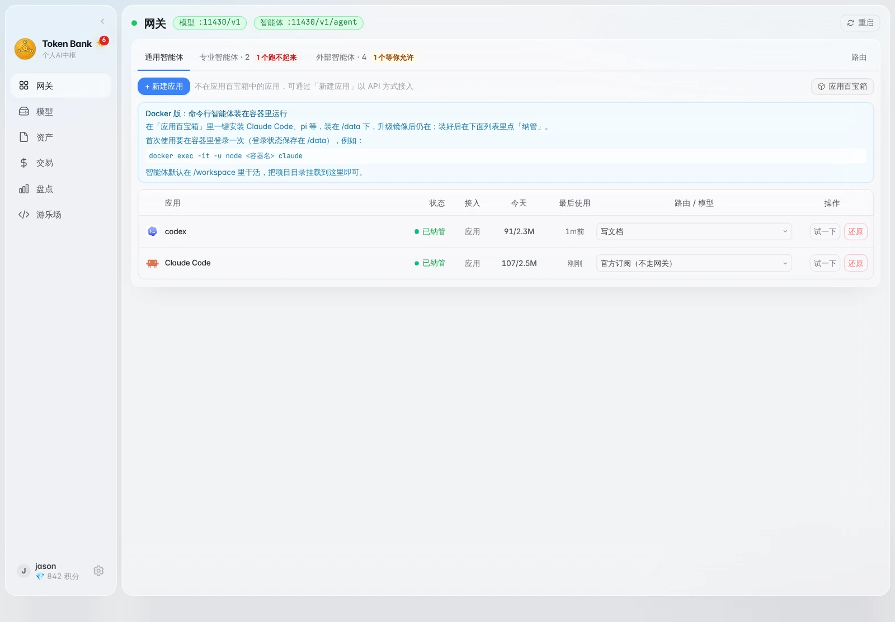

### 网关 · 专业智能体与外部智能体（0.7.0）

资产里的智能体模板投射到应用上跑，每个都能用 `harness_id` 通过接口调用；在别处运行的智能体用配对码接进来，你点允许后它来取任务、送回结果。

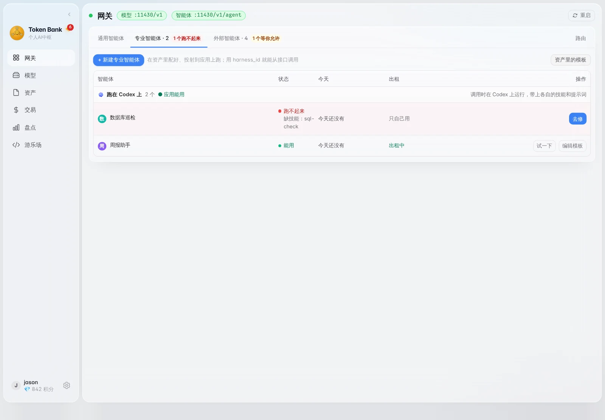

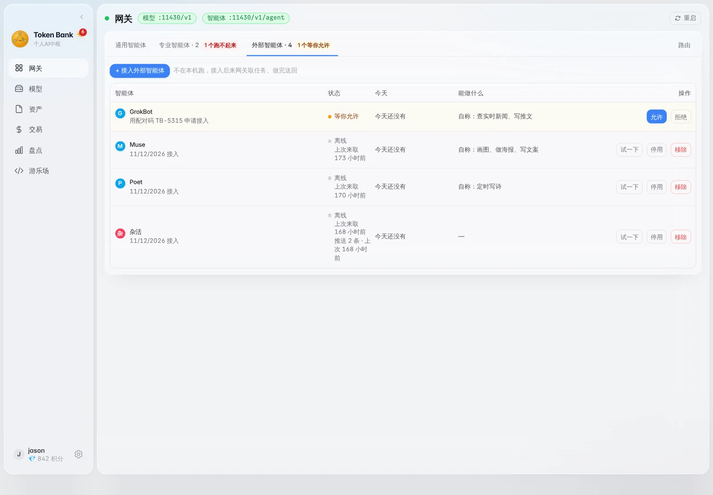

### 会话 · 跨应用统一追溯

在网关列表里点应用的「今天」用量，打开用量明细：数据来源、按模型统计、按会话历史；每个会话都能打开 Trace。

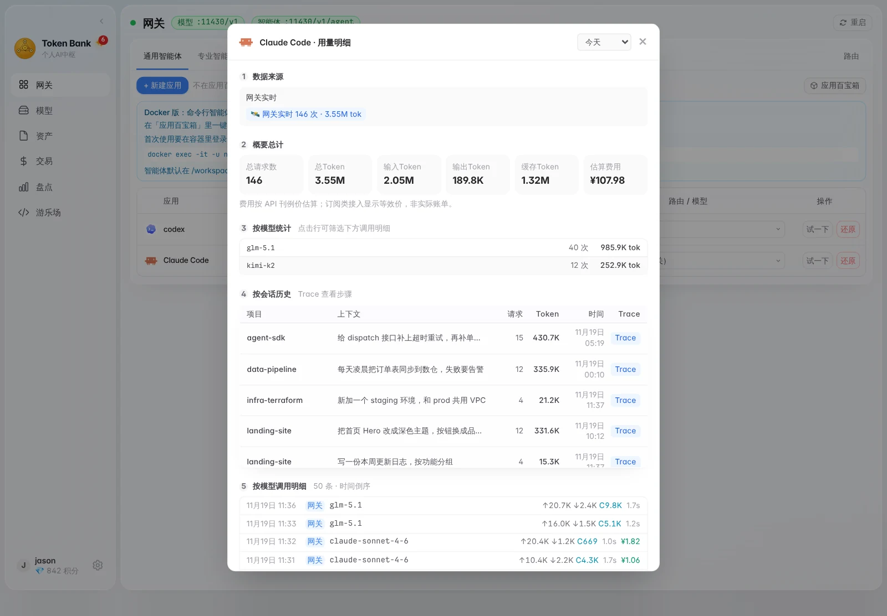

### Session Trace · 步骤级可观测

单次会话的步骤、工具调用、Skill 使用与 Token 明细（含推理密封展示）。

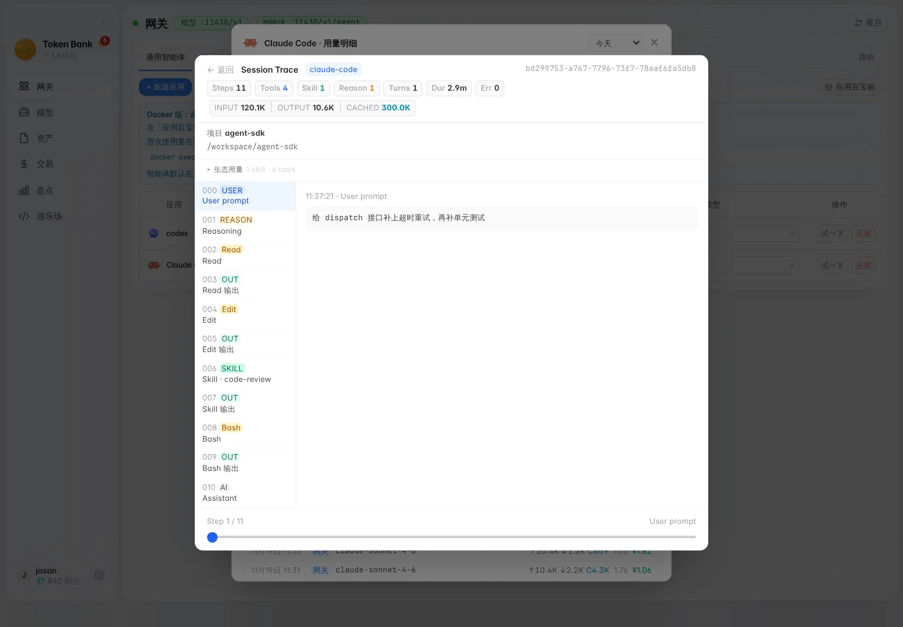

### 模型 · 个人算力 + 社区分享

个人账户模型测速与状态灯；社区共享模型按积分调用。

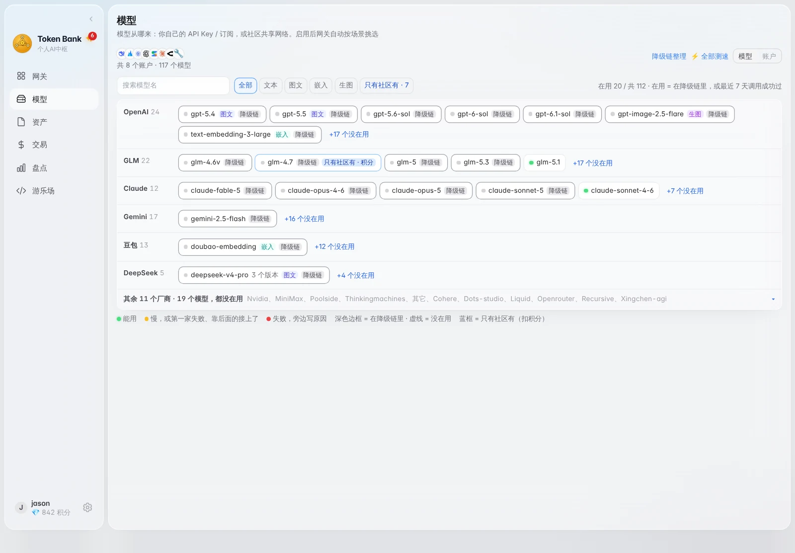

### 资产 · Agent / Skill / Prompt / MCP

提示词、技能、智能体与 MCP 工具统一纳管，一键投射到各运行时；有问题的排在前面，点「看一下」交给智能管家；社区目录从「添加」进入。

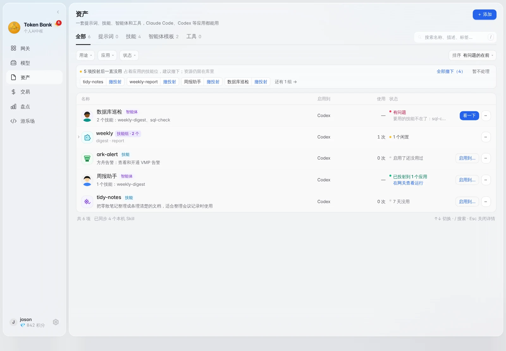

### 游乐场 · Agent 聚合编排

主 Agent 接任务、跑工具，并把子任务并行派发给 Codex / Kimi Code 等其他智能体；左侧可选运行时与已纳管智能体。

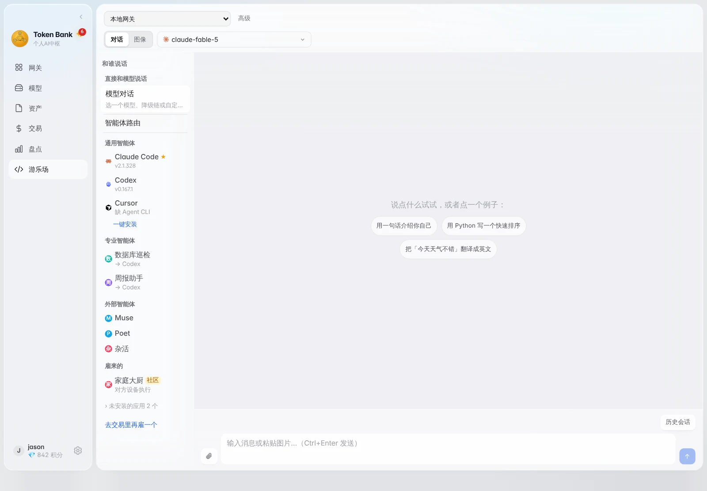

### 盘点 · 用量与费用

请求 / Token / 免费命中率 / 费用估算（订阅按日分摊 + 按量计费）；按应用分布与近 7 天趋势。

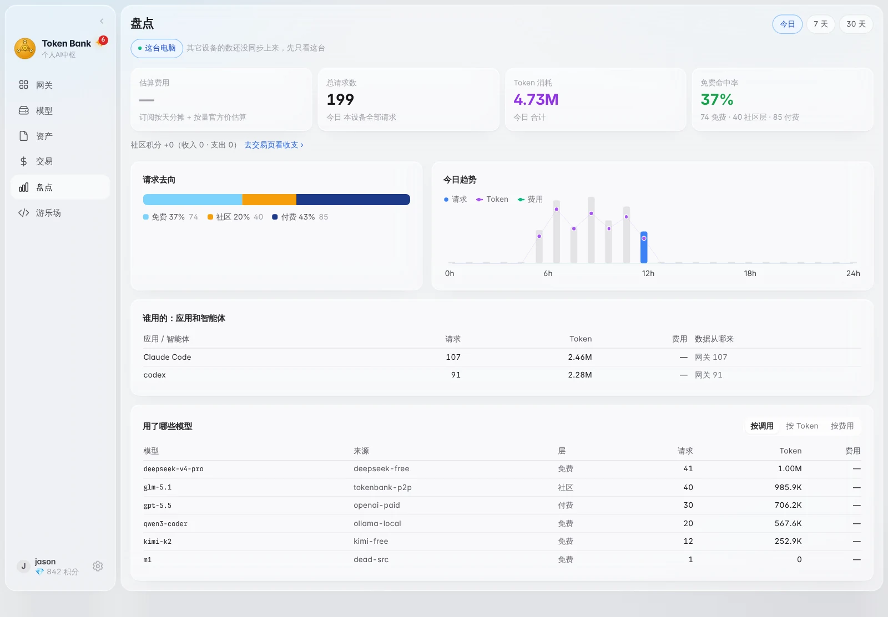

### 圈子 · 只和信任的人交易

圈子是交易的范围：在「交易 → 圈子」创建或加入圈子，上架时选择只给哪些圈子，雇佣时可只看圈内；邀请好友入圈双方得积分。

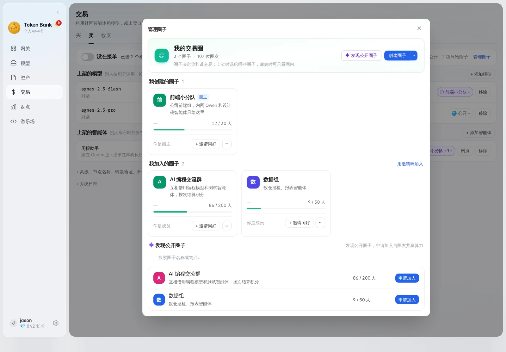

### 交易 · 雇佣智能体与闲置额度生息

按次用积分雇佣社区或圈内智能体（任务在对方设备执行）；也可把本地模型与智能体上架赚积分——只公开名片，配置与 Key 留在本机。

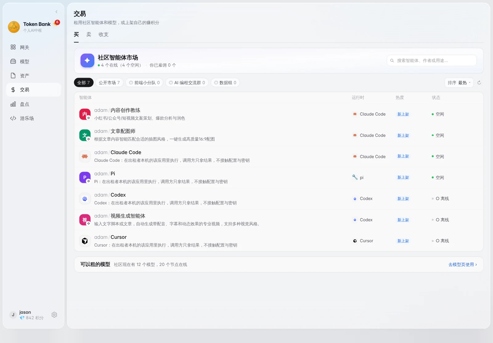

收支页：赚的、花的、余额一张卡看清，最近结算带上每次用到的上架项。

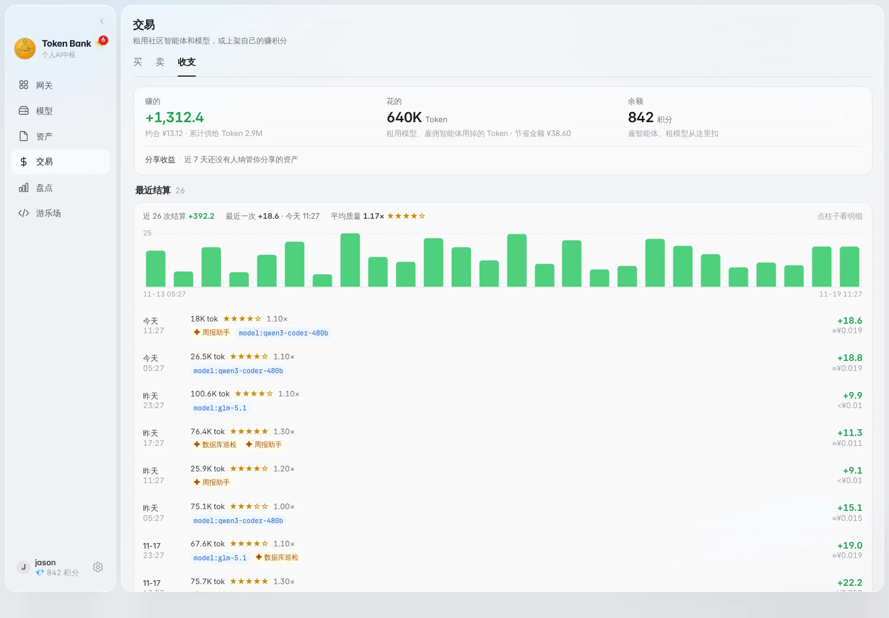

### 托盘 · 常驻速览

网关状态、上下行 Token、各应用路由 / TTFT / 今日用量，一键打开主面板。


| 页面 | 功能 |
|---|---|
| **盘点** | 多维统计：应用占比、**本地源 / 社区分享** 分布、模型排行、压缩节省、费用估算；**按设备胶囊切换**，多设备合一 |
| **网关** | 通用 / 专业 / 外部智能体 + 路由（模型路由、智能体路由）；**一键纳管**（含 WorkBuddy / Trae 等）+ **CLI 多账号**；每个智能体的接口示例与 Key；会话 Trace |
| **调试 / 游乐场** | 「和谁说话」：模型对话、智能体路由、各类智能体；**Agent 聚合编排**（含外部 / 社区智能体、图片输入）；工具流、停止续接 |
| **智能管家** | 资产、投射、任务的问题交给它处理；按规则办、纠正即记住；回复带表格和图表 |
| **资产** | 社区推荐 **MCP / Skill / Prompt / Agent**；投射门控；**内置 MCP 中转**；技能要用的 Key；有问题的排在前面 |
| **模型** | **本地源**与 **社区分享源**；模态（文本/图文/生图/嵌入）；测速与动态目录 |
| **交易（含圈子）** | 买 / 卖 / 收支：**雇佣智能体** · 租模型 · 上架每项单独选公开或圈子 · 近 7 天收益（网页亦可试用） |
| **配置** | 网关端口、超时、并发 · 无损压缩 · 云端账号与转发 Key |

---

## 接入任意 OpenAI 兼容客户端

```bash
# Claude Code（也可在网关页一键纳管，自动注入 ANTHROPIC_BASE_URL）
export ANTHROPIC_BASE_URL=http://localhost:11430

# Codex CLI（网关页纳管后自动注入 OPENAI_BASE_URL）
export OPENAI_BASE_URL=http://localhost:11430/v1

# Cursor / Copilot 等
OPENAI_BASE_URL=http://localhost:11430/v1
OPENAI_API_KEY=your-local-key

# curl 测试
curl http://localhost:11430/v1/chat/completions \
  -H "Authorization: Bearer your-local-key" \
  -H "Content-Type: application/json" \
  -d '{"model":"gpt-4o","messages":[{"role":"user","content":"你好"}],"stream":true}'
```

```bash
# 智能体接口（0.7.0）：同一把 Key，派任务给智能体或智能体路由
curl http://localhost:11430/v1/agent/responses \
  -H "Authorization: Bearer your-local-key" -H "Content-Type: application/json" \
  -d '{"input":"帮我检查这个仓库的测试为什么失败","metadata":{"harness_id":"<harness_id>"}}'
```

> 推荐在 **网关** 页一键纳管，无需手动改环境变量；选择路由后 Agent 仍显示原生模型名，网关透明转发至第三方模型。应用配置页可查看并试用已绑定的资源与 MCP。

---

## 搭建私有 P2P 后端（可选）

如果你想自建服务节点而不是使用公共网络：

```bash
cp .env.example .env
# 编辑 .env，设置 ADMIN_KEY
docker compose up proxy -d
```

| 变量 | 说明 |
|---|---|
| `ADMIN_KEY` | 管理后台密钥 |
| `REQUEST_TIMEOUT` | 单次转发超时秒数（默认 120） |

- 管理后台：`http://YOUR_VPS:8000/admin/ui`
- 用户门户：`http://YOUR_VPS:8000/app`
- Worker 接入：`ws://YOUR_VPS:8000/ws/worker`

### 贡献 Worker 节点

```bash
cd agent && pip install -r requirements.txt

python agent.py register \
  --server   "ws://YOUR_VPS:8000/ws/worker" \
  --worker-key "wk-... 在用户中心复制" \
  --models   "llama3,qwen2" \
  --llm-url  "http://localhost:11434" \
  --name     "我的主机"

python agent.py start
```

**上游 API Key 不上云**：仅存本机 `~/.llm-agent/config.json`，注册时只传 worker_key 和模型名。

---

## 许可证

Apache License 2.0 — 详见 [`LICENSE`](./LICENSE) 与 [`NOTICE`](./NOTICE)。  
再分发或衍生作品须保留 NOTICE，并注明来源：  
**Token Bank · https://github.com/wink-run/tokenbank**

---

## 免责声明

本项目仅供学习与研究使用。使用者须自行遵守所在地法律法规及上游服务条款。因部署、共享算力或转发请求产生的任何后果，均由使用者自行承担。
